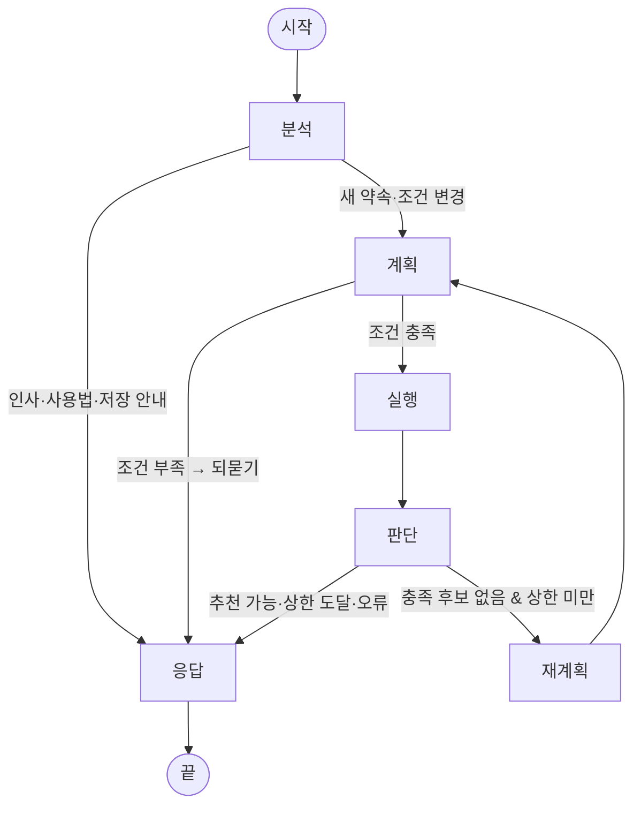

# 약속 장소 플래너

참여자 2~4명의 **위치와 날짜·시작 시각**을 대화로 입력하면, 이동 부담이 작은 **만남 역**과 그 **주변 장소**를 추천하고 약속 계획으로 저장·관리하는 Agent 기반 서비스입니다. (SSAFY AI 코어 프로젝트 3회차 · 도메인: 약속 장소)

## 🔗 배포 주소

| 구분 | URL |
|---|---|
| **서비스 (프론트엔드, Netlify)** | **https://aipjt03.netlify.app/** |
| 백엔드 API (Render) | https://meeting-planner-api.onrender.com · API 문서 `/docs` · 상태 확인 `/api/health` |
| 소스코드 | https://github.com/lemon8988/aipjt03 |

> 백엔드가 무료 호스팅이라 일정 시간 접속이 없으면 잠듭니다. **첫 요청은 30~50초 걸릴 수 있으니** 화면이 반응하지 않아도 잠시 기다려 주세요. 재시작 시 저장한 계획·로그·대화 맥락은 초기화됩니다.

**사용 예시** (대화 화면 입력창)
- `잠실이랑 건대 사는 둘이 토요일 오후 2시에 데이트, 할 거 많은 곳으로`
- 이어서 `같은 조건에서 음식점 많은 쪽으로` (직전 조건을 기억해 후속 처리)

---

## 1. 프로젝트 개요

- **핵심 흐름**: 위치 해석 → 후보 역 조회 → 참여자별 이동시간 조회 → 제약 판단 → 우선순위 정렬 → 주변 장소 추천 → 계획 저장
- **Agent 가 하는 일**: 요청을 분석해 필요한 Tool 을 호출하고, 이동시간·편차·날씨를 사용자의 제약과 비교합니다. 충족하는 후보가 없으면 검색 범위를 넓혀 **재계획**(상한 3회)하고, 대화 맥락을 기억해 후속 요청을 처리합니다.
- **관찰 가능성**: 메인 Agent 는 실행 과정을 이벤트로 발행하고, 별도의 **로깅 Agent** 가 구독해 세션별로 저장·평가합니다.
- **LLM 사용 지점은 3곳뿐**: 요청 분석, 응답 문장 생성, 이상 실행의 원인 진단. 계획·실행·판단은 규칙과 계산식이고, 로깅 Agent 의 수집·저장·판정에는 LLM 을 쓰지 않습니다.
- **기술 스택**: Python · FastAPI · LangGraph · SQLite / HTML·CSS·JavaScript(순수) / 배포: Netlify(프론트) + Render(백엔드)

### 1.1 도메인 선택 근거

| 조건 | 충족 근거 |
|---|---|
| 외부 API 3종 이상 | **카카오 로컬**(위치·후보 역·주변 장소), **카카오맵 대중교통 경로**(이동시간·환승), **Open-Meteo**(날씨) |
| 판단이 필요한 요청 | 이동시간·편차·날씨를 사용자의 제약(최대 이동시간, 편차 상한, 약속 날짜)과 비교해야 답할 수 있음 |
| 재계획이 의미 있는 요청 | 제약을 충족하는 후보 역이 하나도 없으면 반경·후보 수를 넓혀 다시 탐색 |
| 저장·관리할 결과물 | **약속 계획**(날짜, 시작·종료 시각, 참여자, 목적, 만남 역, 선택 장소) 저장·조회·수정·삭제 |
| 위험 도메인 여부 | 아님 (면책 안내 불필요) |

### 1.2 대표 요청 시나리오 (실제 LLM·카카오·날씨 API 로 실행)

| # | 요청 | 기대 · 실제 결과 | 재계획 |
|---|---|---|---|
| S1 | "잠실이랑 건대 사는 둘이 토요일 오후 2시에 데이트, 할 거 많은 곳으로" | 한 번에 충족 → 건대입구역(잠실 13분, 건대 6분) | 0회 |
| S2 | "중앙이랑 건대 사는 둘이 토요일 오후 2시에 만날래, 이동 적게" | 중앙역 모호 → 선택 버튼 → 반경 3000m 에 역이 없어 5000m 로 확대 후 충족 | 1회 |
| S3 | "수원이랑 춘천 사는 둘이 토요일 오후 2시에 만나고 싶어" | 3회 후 상한 도달, 가장 근접한 후보(운길산역 91분, 1분 초과)와 조건 완화 버튼 제시 | 3회(상한) |
| S4 | S1 + `get_route` 일부 실패 주입 | 실패한 후보만 사유와 함께 제외하고 추천 완료 | 0회 |
| S5 | "안녕" | 계획 단계를 건너뛰고 Tool 0회로 응답 | - |
| S6 | "같은 조건에서 음식점 많은 쪽으로" | Tool 호출 0회, 캐시 재사용, 우선순위만 갱신 | - |
| S7 | "송도랑 마석에서 모일 장소 추천해줘" | 날짜·시작 시각을 **Tool 호출 전에** 되묻기 → 답변 후 용산역 추천 | 0회 |
| S8 | S1 요청에서 우선순위 생략 | 우선순위를 선택 버튼으로 되묻기 | - |
| S9 | S1 요청, 카카오 키 없음 | 재계획 없이 설정 안내 | 0회 |
| S10 | "잠실에서 7시 전에 끝나야 해" | 위치·날짜·시작 시각을 지어내지 않고 되묻기 | - |

> 이동시간·장소 수는 실시간 데이터라 실행 시점에 따라 값이 달라질 수 있습니다.

---

## 2. 전체 기능 설명

### 2.1 필수 기능 (F3001 ~ F3019) — 모두 구현

| 영역 | 번호 | 구현 내용 |
|---|---|---|
| Tool | F3001~F3004 | Tool 5종(`geo_loc`, `find_stn`, `get_route`, `find_spot`, `get_wx`)의 이름·설명·입력 스키마를 레지스트리에 등록. 모든 Tool 은 `ok`+`data` 또는 `error(code, message)` 로 같은 형식을 반환하고 예외를 밖으로 던지지 않음 |
| 메인 Agent | F3005 | 요청 분석: 날짜·시작 시각(기준), 위치·목적·우선순위(선호), 이동시간·편차 상한(제약) 추출. 뽑지 못한 값은 `null` 로 두고 되묻기 |
| | F3006 | 작업 계획 수립. 인사·사용법 등 Tool 이 필요 없는 요청은 계획 단계를 건너뜀 |
| | F3007 | Tool 호출·결과 통합(좌표→후보 역→경로→장소). 실패하면 사유를 기록하고 해당 후보만 제외 |
| | F3008 | 제약 적합성 판단: 최대·편차 계산, 우선순위 점수. 확인할 수 없는 값은 "판정 불가", 이동시간은 조회 시점 기준임을 표기 |
| | F3009 | 재계획: 충족 후보 0개일 때만 반경·후보 수 확대, 결과 재사용, 상한 3회, 도달 시 사유와 함께 조건 조정 되묻기 |
| | F3010 | 대화 맥락 유지: 조건·직전 추천 요약·정규화된 Tool 결과를 세션 메모리에 보관, 바뀐 조건만 갱신 |
| | F3011 | 최종 응답: 추천 3곳을 근거(참여자별 이동시간·편차·날씨·장소 수)와 함께 불릿으로 제시, 제외 후보 사유 표기 |
| 로깅 | F3012 | 단계·Tool 호출·LLM 판단·재계획 이벤트 발행 (로깅 Agent 구현에 의존하지 않음) |
| | F3013 | 로깅 Agent 가 세션별 JSONL 로 저장 (수집·저장에 LLM 미사용, 저장 실패해도 대화 정상) |
| | F3014 | 실행 로그 목록·상세·삭제 (수정 API 없음) |
| 계획 | F3015~F3016 | 계획 저장·조회·수정·삭제. 같은 날짜에 시간이 겹치면 저장은 하되 `conflicts` 로 알림 |
| 서버·화면 | F3017 | FastAPI 로 대화·계획·로그 API 를 서로 다른 경로로 제공, Pydantic 모델로 요청·응답 정의 |
| | F3018 | 대화·계획 관리·실행 로그 화면 (순수 HTML/CSS/JS) |
| | F3019 | 실행 단계·Tool 호출 이력·재계획 지점, 처리 중 상태, Tool 실패·키 누락 안내 표시 |

### 2.2 심화 기능

| 번호 | 기능 | 상태 |
|---|---|---|
| **F3020** | **로깅 Agent 이상 징후 판단** | **구현** (4장) |
| F3021 | Planner·Worker 구조 전환 | 선택하지 않음 |
| F3022 | RAG 검색 Tool | 선택하지 않음 (이 도메인에서 쓸 문서가 없음) |
| F3023 | 캘린더 연동 Tool | 선택하지 않음 |

### 2.3 비기능 요구사항 (NF3001 ~ NF3007)

| 번호 | 내용 | 결과 |
|---|---|---|
| NF3001 | API 키는 환경변수로만 관리, 소스·제출물에 키 없음 | ✔ `.env` 는 `.gitignore`, 저장소·문서에서 키 값 검색 0건 |
| NF3002 | 화면에 키·오류 상세 비노출 | ✔ 코드별 안내문만 표시, `/api/health` 는 설정 여부만 반환 |
| NF3003 | Tool 실패해도 서비스 지속 | ✔ 모든 예외를 실패 응답으로 변환 (S4) |
| NF3004 | 재계획 상한 | ✔ 최대 3회 (S3) |
| NF3005 | 응답 시간 | ✔ 후보×참여자 병렬 호출, 상한 초과 후보 조기 생략, 요청당 호출 예산 100회. 배포 서버(Render 무료)·GPT 기준 Tool 호출 요청 10건 중앙값 10.6초, 최대 23.4초 (같은 조건의 로컬 측정은 중앙값 4.3초). 느린 구간은 외부 API 호출(get_route 16회·find_spot 32회)이며, 화면에 처리 중 상태와 실행 단계를 표시해 대기 중임을 알립니다 |
| NF3006 | 프론트·백엔드 분리, 모듈 분리 | ✔ `frontend/` · `backend/`, `agent`·`tools`·`events`·`store`·`api` 파일 분리 |
| NF3007 | 외부 API 출처·이용 조건 기록 | ✔ 아래 5장 |

---

## 3. 시스템 구조

```
사용자 ─→ 프론트엔드(Netlify) ─→ POST /api/chat ─→ 메인 Agent (LangGraph)
                                                    │  분석 → 계획 → 실행 → 판단 → 응답 (+ 재계획 루프)
                                                    │         └ Tool 호출 (외부 API 5종)
                                                    └─ 이벤트 발행 ─→ EventBus ─→ 로깅 Agent (구독자)
                                                                            ├─ 세션별 JSONL 저장 (LLM 미사용)
                                                                            └─ 실행 종료 시 이상 징후 판정(규칙) → 이상일 때만 LLM 진단
```

```
backend/app/
  agent/        main_agent.py (LangGraph 그래프), rules.py (제약 판단·점수), llm.py, memory.py
  tools/        base.py (공통 응답·레지스트리), kakao_local.py, route.py, weather.py, http.py
  events/       bus.py (발행/구독)
  logging_agent.py · evaluation.py (F3020)
  store/plans.py (SQLite)      api/ chat.py · plans.py · logs.py      main.py (FastAPI)
frontend/       index.html (대화) · plans.html (계획 관리) · logs.html (실행 로그)
tests/          자동 테스트 120개 (가짜 외부 API·가짜 LLM)
```

### 3.1 메인 Agent 실행 단계 (Agent 설계)



| 단계 | 하는 일 | LLM | 입력 → 출력 |
|---|---|---|---|
| 분석 | 의도 분류(`new_meet`/`edit_cond`/`save_plan`/`chat`)와 조건 추출. 요일·상대 날짜는 모델이 계산하지 않고 프롬프트의 14일 날짜표에서 찾게 하며, 우선순위 표현(음식점/할 거/이동)은 매핑을 명시. 선택 버튼 응답은 LLM 없이 반영 | 사용 | 메시지 + 메모리 → `intent`, `slots` |
| 계획 | 누락 조건 점검 후 되묻기, 아니면 Tool 호출 계획 구성 | 미사용 | `slots` → `plan` 또는 `ask` |
| 실행 | 위치 해석 → 날씨 → 후보 역 → 후보 압축 → 이동시간 → 제약 필터 → 주변 장소 | 미사용 | `slots` → 후보·판정 결과 |
| 판단 | 점수 계산·정렬, 재계획 여부 결정 | 미사용(계산식) | 통과 후보 → `ranked`, `decision` |
| 재계획 | 검색 반경·후보 수 확대, 이벤트 발행 | 미사용 | 반경·후보 수 갱신 |
| 응답 | 추천·근거·제외 사유를 구조화하고 요약 문장 생성 (실패 시 템플릿) | 문장만 사용 | `ranked`, `excl` → `final` |

`slots = { locs[], purpose, date, start, end, prio, t_max, g_max }` — **뽑지 못한 값은 `null` 로 두고 임의로 채우지 않습니다.**

### 3.2 조건 분류와 되묻기

| 구분 | 조건 | 비어 있을 때 |
|---|---|---|
| 기준 | 날짜, 시작 시각, 종료 시각(선택) | 날짜·시작 시각이 없으면 Tool 호출 **전에** 되묻기. 종료 시각은 `null` 로 저장하고 겹침 판정에만 시작+3시간 사용 |
| 선호 | 위치 2~4곳, 목적, 우선순위(이동 부담 적게/할 거 많게/음식점 많게) | 위치 부족·초과는 되묻기, 우선순위는 선택 버튼으로 되묻기 |
| 제약 | 최대 이동시간(기본 90분), 참여자 간 편차(기본 30분), 강수확률 60% 이상이면 실내 위주 | 기본값을 쓰고 응답에 "기본값을 썼어요" 표기 |

그 밖의 되묻기: 위치가 여러 곳(`AMBIGUOUS` → 후보 버튼), 위치를 찾지 못함, 지난 날짜.

### 3.3 제약 판단 계산식 (F3008)

1. **중심 좌표** = 참여자 좌표의 평균 → `find_stn(중심, 반경)` 으로 후보 역을 받고 노선별 중복을 역명으로 합칩니다.
2. **후보 압축**: 참여자까지 직선거리 합이 작은 상위 K 개 (API 호출 없음).
3. 후보마다 `get_route` 를 참여자 수만큼 호출해 이동시간 `tᵢ`(분)를 얻습니다. **가장 먼 참여자부터** 호출하고 `tᵢ > T_max` 이면 나머지 호출을 생략합니다.
4. **제약 필터**(경계 포함): `max(tᵢ) ≤ 90` 그리고 `max(tᵢ) − min(tᵢ) ≤ 30`. 경로가 없거나 조회에 실패한 후보는 **값을 채우지 않고 판단하지 않은 채 제외**하며 사유를 적습니다.
5. **날씨**: 강수확률 ≥ 60% 이면 `관광명소` 를 일괄 제외하고 그 사실을 응답에 적습니다. 예보 범위 밖·값 없음이면 날씨 판단을 생략합니다.
6. **점수**(동점이면 이동시간 합 → 최대 이동시간이 작은 쪽):

   | 우선순위 | 점수 |
   |---|---|
   | 이동 부담 적게 | `−Σ tᵢ` |
   | 할 거 많게 | 반경 500m 안 음식점·카페·문화시설·관광명소 건수 합 |
   | 음식점 많게 | 반경 500m 안 음식점 건수 |

7. 점수 상위 **3곳**을 추천합니다. 건수를 확인하지 못한 후보는 "판정 불가"로 제외합니다. 직선 500m 이하인데 대중교통 경로가 없으면 도보로 **추정**하고 그렇게 표기합니다.

### 3.4 계획 수립과 재계획 (F3006, F3009)

- **계획**: `[geo_loc, get_wx, find_stn, get_route, find_spot]` 를 계획으로 보관하고 이후 단계에서 참조. `chat`/`save_plan` 은 계획 단계를 건너뜁니다(Tool 0회).
- **재계획한다**: 제약을 충족하는 후보가 **0개**일 때 (후보 역이 아예 없는 경우 포함). 사용자의 이동시간·편차 상한은 임의로 바꾸지 않습니다.
- **재계획하지 않는다**: ① `NO_KEY`·`RATE_LIMIT`·`BAD_INPUT` 처럼 다시 해도 같은 실패 ② 이동시간 조회가 전부 실패해 판단 불가 ③ 되묻기 사유

  | 회차 | 후보 반경 | 후보 수 K |
  |---|---|---|
  | 최초 | 3000m | 8 |
  | 재계획 1회 | 5000m | 8 |
  | 재계획 2회 | 8000m | 8 |
  | 재계획 3회 | 8000m | 12 |

- **재사용**: 이미 조회한 Tool 결과는 `(Tool, 인자)` 키로 세션 메모리에 캐시해 다시 호출하지 않습니다.
- **상한 도달 시**: 가장 근접했던 후보와 초과 폭을 사유로 보여 주고 조건 완화(이동시간 +30분, 편차 +15분) 버튼을 되묻습니다. 중간 지점에 역이 없어서 도달한 경우는 "서로 더 가까운 위치로" 안내합니다.
- 요청당 외부 호출 예산 100회를 넘으면 `RATE_LIMIT` 으로 중단합니다.

### 3.5 이벤트와 로깅 Agent (F3012~F3014)

- 메인 Agent 는 `EventBus.publish(session_id, type, ...)` 로 **발행만** 하며 구독자를 알지 못합니다. 구독자가 없거나 예외를 내도 정상 동작합니다 (`DISABLE_LOGGING_AGENT=1` 로 검증).
- 로깅 Agent 는 구독자로서 이벤트를 받는 즉시 세션별 JSONL 에 **발생 순서대로** 덧붙입니다. 수집·저장에는 LLM 호출이 없고, Tool 응답 원문은 남기지 않습니다(호출 인자·성공 여부·건수·소요 시간만).
- 화면의 "실행 과정"은 `/api/chat` 이 요청 동안만 붙이는 임시 구독자가 만듭니다.

| 이벤트 | 발행 시점 | 주요 필드 |
|---|---|---|
| `step_start` / `step_end` | 단계 진입 / 종료 | `step`, `ms` + 단계별 정보 |
| `tool_req` / `tool_res` | Tool 호출 요청 / 응답 | `tool`, `args` / `ok`, `code`, `ms`, `count` |
| `cache_hit` | 확보한 결과 재사용 | `tool` |
| `llm_decision` | LLM 의 의도 분류 | `kind`, `value`, `reason` |
| `replan` | 재계획 시작 | `n`, `trigger`, `change` |
| `run_end` | 요청 종료 | `status`, `total_ms` |

### 3.6 대화 맥락 (Memory) (F3010)

| 구분 | 내용 |
|---|---|
| 보관 | 조건(`slots`), 해석한 위치 좌표, 직전 추천 요약, 되묻기 상태, 재사용할 Tool 결과 캐시(정규화된 값) |
| 보관하지 않음 | Tool 원본 응답(카카오 약관), 중간 판단 전문 |
| 갱신 | `new_meet` → 조건 초기화 후 새로 추출 / `edit_cond` → **사용자가 말한 값만** 덮어씀. 위치·날짜가 바뀌면 관련 결과가 자연히 재조회되고, 우선순위만 바뀌면 이동시간을 다시 부르지 않음 |
| 한계 | 서버 프로세스 메모리라 재시작하면 사라짐 |

### 3.7 LLM 호출 조건

| 주체 | 호출하는 조건 | 호출하지 않는 조건 |
|---|---|---|
| 메인 Agent 분석 | 사용자 메시지를 받을 때 (GPT `gpt-4o-mini`, OpenAI 호환 Chat Completions, 온도 0, JSON 출력) | 선택 버튼 응답 |
| 메인 Agent 응답 | 추천/상한 도달 요약 문장, 인사·사용법 답변 (실패하면 템플릿 문장) | 되묻기, 오류 안내(고정 문구) |
| 계획·실행·판단 | 호출하지 않음 | 항상 |
| 로깅 Agent 수집·저장·판정 | 호출하지 않음 | 항상 |
| 로깅 Agent 진단 | `verdict=anomaly` 인 실행에만 | 정상(`ok`)·판정 불가(`unknown`) |

---

## 4. 심화 기능 적용 요약 (F3020: 로깅 Agent 이상 징후 판단)

실행(요청 1건)이 끝나면(`run_end`) 로깅 Agent 가 그 실행의 이벤트만 모아 판정합니다.

| 규칙 | 경고 조건 |
|---|---|
| `repeated_call` 반복 호출 | 같은 Tool 이 같은 입력으로 한 실행에서 2회 이상 |
| `excess_replan` 재계획 과다 | 재계획이 상한(3)에 도달 |
| `unplanned_call` 계획 외 호출 | 계획 단계가 정한 Tool 목록에 없는 Tool 호출 |

- **판정에는 LLM 을 쓰지 않습니다.** 결과는 `ok`(정상) / `anomaly`(이상) / `unknown`(**판정 불가**). 실행 시작 이벤트가 없는 등 근거가 없으면 '이상 없음'이 아니라 `unknown` 으로 남깁니다.
- **LLM 원인 진단은 `anomaly` 인 실행에만** 붙고(세 문장 이내), `diagnosis` 필드에 판정과 분리해 저장합니다. 백그라운드로 실행되어 응답을 지연시키지 않고, 실패해도 판정과 로그는 그대로 남습니다.
- 메인 Agent 는 `eval_lookup` 으로 직전 실행 판정을 조회해 분석 단계 종료 이벤트에 `prev_eval`·`prev_warnings` 로 기록합니다(참조·기록만, 흐름 변경은 F3021 범위).
- **필수 기능 결과와의 비교** (실제 서버·실제 LLM 실행)

  | 확인 항목 | 만든 방법 | 결과 |
  |---|---|---|
  | 정상 실행 (S1) | 일반 요청 | `ok`, 진단 `skipped`(LLM 미호출) |
  | 반복 호출 | `ANOMALY_INJECT=repeat_call` | `anomaly` — `get_wx` 가 같은 입력으로 2회 호출 |
  | 재계획 과다 | 실제 요청 "수원+춘천" | `anomaly` — 재계획 3회(상한 도달) |
  | 계획 외 호출 | `ANOMALY_INJECT=unplanned_call` | `anomaly` — 계획에 없던 `get_wx` 호출 |
  | 근거 이벤트 없음 | `ANOMALY_INJECT=missing_events` | **`unknown`(판정 불가)**, 경고 0건 |
  | 메인 Agent 참조 | S3 세션 두 번째 실행 | `prev_eval=anomaly`, `prev_warnings=['excess_replan']` 기록 |

- 이상 주입 환경변수(`ANOMALY_INJECT`)는 검증용이며 운영에서는 비워 둡니다.
- 위 표의 A1~A3 는 로컬에서 주입 환경변수로 만든 실행 기록(당시 LLM 은 Gemini)이고, 재계획 과다(S3)는 GPT 로 배포 서버에서 실행한 기록입니다. **판정은 규칙이라 LLM 과 무관**하고, 모델에 따라 달라지는 것은 진단 문장뿐입니다.
- **한계**: '재계획 과다'를 상한 도달로 정의했기 때문에 사용자 조건이 충족 불가능한 요청(수원+춘천)도 `anomaly` 로 판정됩니다. 진단 프롬프트에 '사용자 조건 문제' 구분 기준을 넣었지만, GPT 진단은 S3 를 "메인 Agent 의 판단 과정" 문제로 분류하면서 조치는 "사용자 제약 재검토"로 제시해 원인 구분이 불완전했습니다. 진단의 정확도는 보장되지 않습니다.

---

## 5. 사용한 외부 API의 출처와 이용 조건 (NF3007)

| API | 출처 | 용도 | 이용 조건 |
|---|---|---|---|
| 카카오 로컬 | [카카오 개발자 문서](https://developers.kakao.com/docs/latest/ko/local/dev-guide) | 위치 해석, 후보 역, 주변 장소 | 호출 한도: 앱 설정 기준 전체 API 3,000,000건. **응답 저장 금지** → 실시간 호출만 하고 저장하는 것은 사용자가 확정한 이름·시각뿐(좌표·주소·URL 미저장) |
| 카카오맵 대중교통 경로 조회 | [카카오맵 REST API](https://developers.kakao.com/docs/ko/kakaomap/rest-api) | 참여자→후보 역 이동시간 | 같은 REST API 키·한도. 응답 저장 금지(보수적으로 해석). 출발 시각을 지정할 수 없어 **조회 시점 기준**. 요청 1건에 약 16회 호출 |
| Open-Meteo | [open-meteo.com](https://open-meteo.com/en/docs) | 약속 날짜 강수확률·기온 | 키 불필요, **비상업 무료, CC BY 4.0**(응답 `meta.notes` 에 출처 표기). 예보는 오늘+14일까지만 사용 |
| LLM (GPT, OpenAI 호환) | [SSAFY GMS](https://gms.ssafy.io/web/) · [OpenAI API](https://platform.openai.com/docs) | 요청 분석·응답 문장·이상 진단 | GMS 교육용 키 또는 OpenAI 키(환경변수). 키는 소스·제출물에 포함하지 않음 |

### API 키 발급 및 설정 절차 요약

| 키 | 발급 | 설정 (환경변수) |
|---|---|---|
| 카카오 REST API 키 | [developers.kakao.com](https://developers.kakao.com) → 애플리케이션 생성(**앱은 1개만**) → 앱 키의 REST API 키 → 카카오맵·로컬 API **활성화** | `KAKAO_REST_KEY` |
| LLM 키 | SSAFY GMS 발급 키 (또는 OpenAI 키) | `LLM_API_KEY`, `LLM_MODEL=gpt-4o-mini`, `LLM_BASE_URL=https://gms.ssafy.io/gmsapi/api.openai.com/v1` (`…/chat/completions` 까지 넣어도 코드가 `…/v1` 로 정리. 비우면 `https://api.openai.com/v1`). 온도 0 을 쓰므로 gpt-5 계열은 쓰지 않습니다 |
| Open-Meteo | 키 불필요 | - |
| (배포) 프론트 주소 | Netlify 에 배포한 주소 | 백엔드 `CORS_ORIGINS` |

키는 코드에 넣지 않고 백엔드 호스팅(Render)의 환경변수로만 설정했습니다. Render 환경변수: `KAKAO_REST_KEY`, `LLM_API_KEY`, `LLM_BASE_URL`, `LLM_MODEL`, `CORS_ORIGINS`, `PYTHON_VERSION`(3.12.8). Netlify 는 환경변수 없이 `frontend/` 정적 파일만 배포합니다. `.env.example` 에 변수 목록이 있고 `.env` 는 저장소에 올리지 않습니다.

---

## 6. Tool 정의서

| Tool | 외부 API | 언제 쓰는가 |
|---|---|---|
| `geo_loc` | 카카오 로컬 키워드 검색 | 사용자가 말한 위치(역명·동네)를 좌표로 바꿀 때. 같은 이름이 여럿이면 `AMBIGUOUS` |
| `find_stn` | 카카오 로컬 카테고리(SW8) | 참여자 중심 좌표 주변 후보 지하철역이 필요할 때 |
| `get_route` | 카카오맵 대중교통 경로 | 참여자→후보 역 이동시간(분)·환승 수가 필요할 때 (조회 시점 기준) |
| `find_spot` | 카카오 로컬 카테고리/키워드 | 후보 역 주변 음식점·카페·문화시설·관광명소와 반경 내 건수가 필요할 때 |
| `get_wx` | Open-Meteo | 약속 날짜 강수확률로 실내·야외를 가를 때 |

필수 Tool 3개 = 후보 조회 `find_stn`, 상세정보 `get_route`, 보조 정보 `find_spot`. `geo_loc`·`get_wx` 는 입력을 만들기 위한 보조 Tool 입니다. 로컬 서버 API 툴은 F3022/F3023 을 선택하지 않아 없습니다.

### 6.1 입력 · 출력

| Tool | 입력 (필수 ✔) | 출력 `data` |
|---|---|---|
| `geo_loc` | `q`✔, `size`(기본 5) | `items[{id, name, addr, x, y}]` |
| `find_stn` | `x`✔, `y`✔, `radius_m`(기본 3000), `size`(15) | `stations[{id, name, x, y, dist_m}]` 가까운 순, 노선별 중복은 역명으로 합침 |
| `get_route` | `from{x,y}`✔, `to{x,y}`✔ | `{min, transfers, mode}` — `mode`: `transit`/`same_place`/`walk_estimate`. 응답 `totalTime` 은 초라 분으로 환산, 경로가 여러 개면 최단 |
| `find_spot` | `x`✔, `y`✔, `cat`✔(음식점·카페·문화시설·관광명소), `radius_m`(500), `q`, `size`(5) | `{items[{id,name,cat,addr,url,dist_m}], total, pageable}` — `total`=반경 내 전체 건수(점수 계산용) |
| `get_wx` | `x`✔, `y`✔, `date`✔(YYYY-MM-DD) | `{rain_pct, tmax, tmin}` |

### 6.2 공통 응답 형식

```json
{ "ok": true,  "data": { }, "meta": { "basis": "조회 기준 설명", "notes": ["부가 설명"] } }
{ "ok": false, "error": { "code": "NO_RESULT", "message": "사유", "detail": null } }
```

### 6.3 실패 케이스와 처리 방식

| 코드 | 의미 | Agent 처리 |
|---|---|---|
| `NO_KEY` | API 키 없음/유효하지 않음 (HTTP 401·403) | **재계획 없이** 설정 안내 후 중단 |
| `BAD_INPUT` | 필수 인자 누락·형식 오류 (HTTP 400) | 재계획 없이 되묻기/오류 처리 |
| `NO_RESULT` | 검색 결과 없음 | `find_stn`: 반경 확대 재계획 / `find_spot`: 개수 0 으로 점수 반영 / `geo_loc`: 더 구체적으로 되묻기 / `get_wx`: 날씨 판단 생략 |
| `NO_ROUTE` | 두 지점 사이 대중교통 경로 없음 | **해당 후보만 제외**하고 사유 표기 (값을 지어내지 않음). 직선 500m 이하는 도보 추정 |
| `AMBIGUOUS` | 같은 이름의 위치가 여럿 | 후보를 선택 버튼으로 되묻기 (재계획 아님) |
| `OUT_OF_RANGE` | 예보 범위 밖 (오늘+14일 초과) | 날씨 판단 생략, 그 사실 표기 |
| `RATE_LIMIT` | 호출 한도 초과 (HTTP 429, 요청당 예산 초과, 카카오 대중교통의 한도 초과는 HTTP 400 `API limit has been exceeded` / code -10) | 재계획 없이 잠시 후 재시도 안내 |
| `API_ERROR`, `TIMEOUT` | 외부 API 오류·시간 초과 | 같은 인자로 **1회만 재시도**, 실패하면 해당 후보를 "판정 불가"로 제외 |

### 6.4 Tool 등록 및 확장 방법

1. `backend/app/tools/` 에 모듈을 만들고 `ToolError(code, message)` 를 던지거나 `ok(...)` 를 반환하는 함수를 작성합니다. 외부 호출은 `tools/http.py` 의 `request_json` 을 씁니다 (상태 코드 → 실패 코드 변환, 타임아웃/5xx 1회 재시도).
2. 모듈 끝에서 `register(ToolSpec(name, description, input_schema, fn, required, kind))` 로 등록합니다. 설명에는 **언제 쓰는지**를 적습니다.
3. `tools/__init__.py` 에 import 하면 레지스트리에 등록되고, `list_specs()` 가 Agent 에 노출할 명세를 만듭니다.
4. 호출은 항상 `call_tool(name, args)` 를 거칩니다: 필수 인자 확인 → (선택) 실패 주입 → 실행 → 모든 예외를 실패 응답으로 변환.
5. 메인 Agent 의 계획과 실행 노드에서 호출 순서·값 전달을 연결합니다.

검증용 실패 주입: `FAIL_INJECT="get_route:NO_ROUTE:3"` (해당 Tool 3번에 1번 실패).

---

## 7. API 명세서

기본 주소: 백엔드 `https://meeting-planner-api.onrender.com` · 자동 문서 `/docs`

| 메서드 | 경로 | 설명 | 성공 |
|---|---|---|---|
| POST | `/api/chat` | 대화 요청 (분석→계획→실행→판단→응답) | 200 |
| GET | `/api/plans` | 계획 목록 | 200 |
| POST | `/api/plans` | 계획 저장 (겹치면 `conflicts` 로 알림) | 201 |
| GET | `/api/plans/{plan_id}` | 계획 상세 | 200 / 404 |
| PUT | `/api/plans/{plan_id}` | 계획 수정 (보낸 필드만 갱신) | 200 / 404 / 422 |
| DELETE | `/api/plans/{plan_id}` | 계획 삭제 | 204 / 404 |
| GET | `/api/logs` | 실행 로그 세션 목록 (+ 판정 요약) | 200 |
| GET | `/api/logs/{session_id}` | 세션 상세 (이벤트를 실행 순서대로) | 200 / 404 |
| DELETE | `/api/logs/{session_id}` | 세션 로그 삭제 (평가도 함께) | 204 / 404 |
| GET | `/api/logs/{session_id}/evaluations` | 실행별 이상 징후 판정·진단 (F3020, 읽기 전용) | 200 / 404 |
| GET | `/api/health` | 설정 여부 (키 **값**은 노출하지 않음) | 200 |

**실행 로그는 목록·상세·삭제만 있고 수정 API 는 없습니다.** 시각은 UTC ISO 8601 이며 화면에서 한국 시각으로 변환합니다.

### 7.1 대화 `POST /api/chat`

요청
```json
{ "session_id": "(선택, 8~64자 영숫자·_-)", "message": "잠실이랑 건대 사는 둘이 토요일 오후 2시에 데이트, 할 거 많은 곳으로", "choice": null }
```
- `session_id`: 없으면 서버가 발급, 같은 값을 보내면 대화 맥락이 이어집니다.
- `message`: 최대 500자(`choice` 가 있으면 비워도 됨)
- `choice`: 선택 버튼 응답 `{ "kind": "priority"|"disambiguate"|"patch", "value": …, "name": … }` — LLM 을 쓰지 않고 처리합니다.

응답

| 필드 | 설명 |
|---|---|
| `session_id` | 세션 id |
| `type` | `answer` / `ask`(되묻기) / `error` |
| `status` | `ok`(추천) / `chat`(Tool 불필요) / `ask` / `limit`(재계획 상한) / `no_data`(조회 실패로 판정 불가) / `error` |
| `answer` | 사용자에게 보여 줄 문장 |
| `ask` | 되묻기 `{ kind, message, choices[{label,value}], name? }`. `kind`: `missing` / `priority` / `disambiguate` / `relax` / `relax_region` |
| `result` | 추천 결과 또는 `null` |
| `error_code` | `NO_KEY` `RATE_LIMIT` `UPSTREAM` `LLM_NO_KEY` `LLM_ERROR` `INTERNAL` |
| `timeline` | 이번 요청의 실행 이벤트 목록 (화면의 "실행 과정") |
| `evaluation` | 로깅 Agent 의 이번 실행 판정 (꺼져 있으면 `null`) |

`result` 구조 (발췌)
```json
{ "date": "2026-11-21", "date_note": "2026-11-21(토)", "replans": 0,
  "criteria": { "t_max": 90, "g_max": 30, "prio": "things", "prio_label": "할 거 많게" },
  "weather": { "rain_pct": 0, "tmax": 0.5, "tmin": -5.4, "rainy": false },
  "recommendations": [ { "rank": 1, "station": "건대입구역",
      "times": [ { "name": "잠실", "min": 13, "transfers": 0, "walk": false }, { "name": "건대", "min": 6, "transfers": 0, "walk": false } ],
      "max_t": 13, "min_t": 6, "gap": 7, "sum_t": 19, "score": 861.0,
      "spots": { "음식점": { "total": 667, "items": [ { "name": "…", "addr": "…", "url": "https://…", "dist_m": 5 } ] } } } ],
  "excluded": [ { "name": "자양역", "reason": "경로를 찾지 못해 판단하지 않음 (NO_ROUTE)" } ],
  "near_miss": null, "notes": [ "이동시간은 조회 시점 기준이며 …" ],
  "plan_draft": { "date": "2026-11-21", "start_time": "14:00", "end_time": null, "participants": ["잠실", "건대"], "purpose": "데이트", "priority": "things" } }
```

오류: `message`·`choice` 모두 없음/500자 초과/세션 id 형식 오류 → 422 · 키 없음·LLM 실패 → 200 + `type="error"` 안내문(키 값·내부 오류 비노출) · 처리되지 않은 예외 → 500 `{"error_code":"INTERNAL", ...}`

### 7.2 계획 관리 `/api/plans`

`PlanIn`(POST) / `PlanOut`(응답)

| 필드 | 타입 | 필수 | 설명 |
|---|---|---|---|
| `date` | string | ✔ | `YYYY-MM-DD` |
| `start_time` | string | ✔ | `HH:MM` |
| `end_time` | string? | | 시작보다 늦어야 함. 비우면 `null` (겹침 판정에만 시작+3시간) |
| `participants` | string[] | ✔ | 1~8개 |
| `purpose`, `priority`, `spot` | string? | | 목적 / `travel`·`things`·`food` / 선택 장소 |
| `station` | string | ✔ | 만남 역 |
| `id`, `created_at`, `updated_at` | | (응답) | |

- `POST` → 201 `{ "plan": {…}, "conflicts": [ { "id", "date", "start_time", "end_time", "station" } ] }` — 같은 날짜에 시간이 겹쳐도 **저장은 하고** 겹치는 계획을 알립니다(맞닿는 경계는 겹침 아님).
- `PUT /{id}` — 보낸 필드만 수정, 응답은 같은 형식(겹침 재계산). 형식·시각 순서 오류는 422.
- `GET` 목록(날짜·시작 시각순) / 상세, `DELETE` → 204. 좌표·주소·URL 은 저장하지 않습니다(카카오 약관).

### 7.3 실행 로그 `/api/logs`

- `GET /api/logs` → `[ { session_id, started_at, last_at, event_count, runs, last_status, replans, latest_verdict, anomaly_runs, evaluated_runs } ]` (최근 활동순)
- `GET /api/logs/{session_id}` → `{ session_id, events: [ { seq, ts, type, … } ] }` 실행 순서대로. Tool 응답 원문은 없음
- `DELETE /api/logs/{session_id}` → 204 (평가도 함께 삭제)
- `GET /api/logs/{session_id}/evaluations` → 실행별 `{ run_index, verdict, warnings[{code, message, evidence}], checks, stats, diagnosis{status, text} }`
  - `verdict`: `ok` / `anomaly` / `unknown`, `checks` 값: `ok`/`warn`/`na`, `diagnosis.status`: `skipped`/`pending`/`done`/`failed`

### 7.4 상태 확인 `GET /api/health`

```json
{ "status": "ok", "kakao_key": true, "llm_key": true, "route_provider": "kakao", "logging_agent": true }
```

### 7.5 공통

- CORS: 로컬 프론트와 배포된 프론트(`CORS_ORIGINS`)만 허용
- 세션 id 는 파일 이름에 쓰이므로 `^[A-Za-z0-9_-]{8,64}$` 만 허용 (경로 조작 방지)

---

## 8. 검증 결과

자동 테스트 **120개 통과**(가짜 외부 API·가짜 LLM). 아래는 실제 서버·실제 LLM(GPT)·실제 API 로 확인한 결과입니다. 시나리오 S1~S3·S5~S8·S10 은 2026-11-20 배포 서버에서 실행한 기록이고, 실패·키 제거·로깅 끔 주입이 필요한 S4·S9·S11 과 F3020 주입 실행(A1~A3)은 같은 날 로컬 실행(당시 LLM 은 Gemini) 기록입니다.

### 8.1 기획 검증: 외부 API 호출 확인

| API | 확인한 사항 |
|---|---|
| 카카오 로컬 키워드(SW8) | 같은 역이 노선별로 여러 건 → **역명으로 합쳐야 함** |
| 카카오 로컬 카테고리 | `total_count`·`pageable_count` 존재. `pageable_count` 는 45 로 잘려 점수에는 `total_count` 사용 |
| 카카오 로컬 결과 없음 | `documents: []` → `NO_RESULT` |
| 카카오맵 대중교통 | 첫 호출 HTTP 400(`origin/destination` 가정이 틀림) → `start_x, start_y, end_x, end_y` 로 수정. `totalTime` 은 **초** |
| Open-Meteo | `daily.precipitation_probability_max`, `temperature_2m_max/min` |
| LLM (GPT) | 배포 서버에서 GMS 경유 `gpt-4o-mini` 호출 성공(요청 분석 JSON·응답 문장·이상 진단 정상). 처음 `LLM_BASE_URL` 에 `…/chat/completions` 전체를 넣어 실패해 코드에서 `…/v1` 로 정리하도록 보완. Tool 명세를 넘겨 Tool 선택을 보는 시험(`scripts/check_apis.py --llm`)은 Gemini 로 확인했고 GPT 로는 다시 하지 않았음(이 서비스의 Tool 호출 순서는 계획 단계가 정하며 LLM 은 분석·문장·진단에만 사용) |

### 8.2 설계 변경 (검증·구현·실제 호출에서 발견)

| # | 최초 설계 | 변경 | 계기 |
|---|---|---|---|
| 1 | 대중교통 파라미터 `origin/destination` 가정 | `start_x/start_y/end_x/end_y`, 시간은 초 | 실제 호출 HTTP 400 |
| 2 | 경로 없는 후보는 제외 | 직선 500m 이하는 **도보 추정**으로 대체하고 표기 | 130~300m 구간에서 방향에 따라 `NO_RESULTS` → 참여자 옆 역을 잃음 |
| 3 | `find_spot.total` 기준 미정 | `total_count` | `pageable_count` 가 45 로 잘림 |
| 4 | 재계획 조건 "필터 통과 0개" | 후보 역 자체가 없는 경우 포함. 조회가 전부 실패한 경우는 재계획하지 않음 | 설계 시험 |
| 5 | 상한 도달 시 항상 제약 완화 버튼 | 역이 없어서 도달한 경우는 "서로 더 가까운 위치로" 안내 | 서울+부산 실행에서 엉뚱한 안내 발견 |
| 6 | `get_wx` 후보 역별 호출 | 중심 좌표 **1회** | 설계서 충돌 |
| 7 | 강수 시 야외 제외 기준 없음 | `관광명소` 일괄 제외 + 근거 표기 | 카카오 카테고리에 실내외 구분 없음 |
| 8 | LLM 이 날짜 없는데 오늘 날짜를 채움 | 프롬프트 강화 + 코드 가드(`drop_unsupported_today`) | "잠실에서 7시 전에 끝나야 해" 검증 |
| 9 | 점수 동점 시 순서 불안정 | 이동시간 합 → 최대 이동시간 순 정렬 | 실제 결과에서 동점 3곳 발생 |
| 10 | LLM: GMS 경유 Gemini | GPT(`gpt-4o-mini`, OpenAI 호환 경로)로 통일, Gemini 전용 코드 제거 | 명세서 필수 라이브러리(langchain-openai·openai) 기준 |
| 11 | 로그 시각 UTC 그대로 표시 | 화면에서 한국 시각으로 변환 | 스크린샷 검증 중 9시간 어긋남 발견 |
| 12 | 시나리오: "송도+마석" 재계획, "서울+부산" 상한 | "중앙+건대"(재계획 1회), "수원+춘천"(상한)으로 교체 | 실제 호출 시 송도+마석은 재계획 없이 충족, 서울+부산은 중간 지점에 역이 없음 |
| 13 | 요일→날짜 변환을 LLM 계산에 맡김 | 프롬프트에 오늘부터 14일 날짜표를 넣어 표에서 찾게 함 | GPT 가 "토요일"을 지난 날짜로 계산해 되묻기로 빠짐(같은 요청 4회 중 2회). 수정 후 같은 요청 10회 모두 정상 |
| 14 | 우선순위를 "있으면 채움"으로만 지시 | 표현 매핑(음식점→food, 할 거→things, 이동→travel)과 후속 요청 예시 추가 | GPT 가 "같은 조건에서 음식점 많은 쪽으로"에서 우선순위를 비워 기존 값이 유지됨. 수정 후 동일 대화 8회 모두 `음식점 많게` 반영 |
| 15 | `LLM_BASE_URL` 을 입력 그대로 사용 | 끝의 `/chat/completions`·`/` 를 제거해 `…/v1` 로 정리 | 전체 엔드포인트를 넣으면 경로가 중복되어 LLM 호출 실패 |
| 16 | 카카오의 HTTP 400 을 모두 `BAD_INPUT` 으로 처리 | 응답이 `API limit has been exceeded`(code -10)이면 `RATE_LIMIT` 으로 분류 | 검증 중 대중교통 API 일일 한도를 넘기자 "다른 역으로 변경해 보세요"라는 틀린 안내가 나옴. 이제 "호출 한도에 도달했어요. 잠시 후 다시 시도해 주세요"로 안내하고 남은 호출을 중단 |

### 8.3 대표 시나리오 실행 결과 (대표 요청 11개)

| 시나리오 | 결과 | 재계획 | 소요 |
|---|---|---|---|
| S1 한 번에 충족 | `answer/ok` | 0회 | 23.4초 |
| S2 재계획 후 충족 | `answer/ok` | 1회 | 18.9초 (되묻기 2.4 + 재실행 16.5) |
| S3 상한 도달 | 상한 도달 후 조건 완화 되묻기 | 3회 | 12.7초 (완화 후 재실행 8.4초) |
| S4 Tool 하나 실패 ※ | `answer/ok` | 0회 | 6.3초 |
| S5 Tool 불필요 | `answer/chat` | 0회 | 3.1초 |
| S6 후속 요청 | `answer/ok` (Tool 호출 0회) | 0회 | 5.3초 |
| S7 조건 부족 → 답변 | 되묻기 후 `answer/ok` | 0회 | 21.3초 (되묻기 2.0 + 답변 19.3) |
| S8 우선순위 되묻기 | 선택 버튼 후 `answer/ok` | 0회 | 15.0초 (되묻기 1.9 + 버튼 13.1) |
| S9 API 키 누락 ※ | `error` (설정 안내) | 0회 | 1.2초 |
| S10 임의 채움 방지 | `ask` (지어내지 않음) | 0회 | 1.7초 |
| S11 로깅 Agent 미연결 ※ | `answer/ok` (정상 동작) | 0회 | 5.0초 |

※ S4·S9·S11 은 실패 주입·키 제거·로깅 끔 환경변수가 필요해 같은 날 로컬에서 실행한 기록입니다(당시 LLM 은 Gemini). 나머지는 2026-11-20 배포 서버(Render 무료)·GPT 실행 기록이며, 외부 API 호출 지연 때문에 로컬 측정(1~6초)보다 길게 나옵니다.

※ S6: GPT 첫 실행에서 우선순위가 갱신되지 않는 문제를 발견해 분석 프롬프트에 우선순위 표현 매핑을 추가했습니다(8.2의 14번). 수정 후 같은 대화를 8회 반복해 모두 `음식점 많게` 로 반영되는 것을 확인했습니다. 이 확인 직후 카카오맵 대중교통 API 의 일일 호출 한도를 초과해(HTTP 400, 9장) 수정 후 화면은 다시 찍지 못했고, `docs/screenshots/09_chat_S6_followup.png` 는 수정 전 실행 화면입니다.

**S1 상세 (전체 실행 로그 요약)**

- 요청: `잠실이랑 건대 사는 둘이 토요일 오후 2시에 데이트, 할 거 많은 곳으로`
- 실행 단계: analyze → plan → execute → judge → respond
- Tool 호출: `geo_loc`×2, `get_wx`×1, `find_stn`×1, `get_route`×16, `find_spot`×32 (결과 없음 5건) · 재계획 0회
- LLM 판단: `new_meet` — 사용자가 새로운 약속을 추천해달라고 요청하며, 구체적인 장소와 시간, 목적을 제시했다 (GPT 기록)
- 로깅 Agent 판정: `ok`

| 순위 | 역 | 이동시간(환승) | 최대/편차 | 점수 | 주변 장소 수 |
|---|---|---|---|---|---|
| 1 | 건대입구역 | 잠실 13분(0), 건대 6분(0) | 13/7분 | 863 | 음식점 669, 카페 175, 문화시설 14, 관광명소 5 |
| 2 | 잠실새내역 | 잠실 2분(0), 건대 11분(0) | 11/9분 | 570 | 음식점 477, 카페 89, 문화시설 4, 관광명소 0 |
| 3 | 잠실역 | 잠실 0분(0), 건대 9분(0) | 9/9분 | 528 | 음식점 374, 카페 131, 문화시설 18, 관광명소 5 |

기대와 실제의 차이: **없음.**

**S2 상세 (재계획 사례)**: "중앙" 위치가 모호해 선택 버튼으로 되물음 → 반경 3000m 에서 `find_stn` 결과 0건(`NO_RESULT`) → **재계획 1회**(반경 3000→5000m) → 이미 확보한 결과는 `cache_hit` 으로 재사용하고 새 후보만 호출 → 후보 8곳 중 6곳 충족 → 추천(대공원역).

**S3 상세 (상한 도달)**: "수원+춘천" → 재계획 3회(3000→5000→8000→8000m, 후보 수 12) 후에도 충족 0곳 → 상한 도달, 가장 근접한 후보(운길산역 91분, 1분 초과)를 사유로 제시하고 이동시간·편차 완화 버튼을 되물음(완화 버튼 후 운길산역 추천). 로깅 Agent 는 이 실행을 `anomaly`(재계획 과다)로 판정했고, GPT 의 LLM 진단은 "메인 Agent 의 판단 과정" 문제로 분류하면서 조치는 "사용자 제약 재검토"로 제시했습니다(4장 한계). 이동시간은 실시간 값이라 실행 시점마다 근접 후보와 초과 폭이 달라질 수 있습니다.

### 8.4 개발 중 발견해 수정한 차이

| 차이 | 원인 | 수정 |
|---|---|---|
| 참여자 바로 옆 역이 "경로 없음"으로 제외될 위험 | 아주 가까운 구간에서 `NO_RESULTS` | 500m 이하는 도보 추정 |
| 이벤트 발행 중 `TypeError` | `type` 필드명이 `publish(type=…)` 인자와 충돌 | 필드명을 `response_type` 으로 변경, 통합 테스트 추가 |
| 결과 0건(`NO_RESULT`)이 화면에서 실패처럼 보임 | 표시 문구 구분 없음 | "결과 없음"으로 표기 |
| 이상 진단이 사용자 조건 문제를 Agent 결함으로 결론 | 진단 프롬프트에 구분 기준 없음 | 구분 기준 추가 후 재진단으로 확인 |
| 응답이 줄글 문단이라 읽기 어려움 | 응답 작성 프롬프트 형식 미지정 | 소제목+불릿 형식으로 지정 |

### 8.5 제출 전 점검 목록

| 항목 | 상태 |
|---|---|
| 필수 기능 F3001 ~ F3019 가 모두 동작한다 | ✔ |
| 선택한 심화 기능(F3020)이 동작하고 필수 기능 결과와 비교되어 있다 | ✔ (4장) |
| 증명용 스크린샷·실행 로그를 첨부했다 | ✔ 저장소 `docs/screenshots/`(29장: 23장은 배포 서버·GPT 재촬영, 07·11b·11c·21~23 은 주입 환경변수가 필요해 로컬 실행 캡처), `docs/samples/` |
| 요구사항 · Agent 설계 · Tool 정의서 · API 명세서 · 소스코드 · 실행 로그 샘플 · README 를 포함했다 | ✔ 본 README 에 수록, 상세 원본은 저장소 `docs/` |
| 대표 요청 1건 전체 로그, 재계획 사례를 포함했다 | ✔ 8.3 (원본: `docs/samples/S1_full_run_log.md`, `S2_replan_run_log.md`) |
| 셀프 체크리스트로 점검을 마쳤다 | ✔ 저장소 `docs/셀프체크리스트.xlsx` (통과 26 · 해당없음 5 · 미확인 1 · 실패 0, 증빙 사진 삽입). 미확인 1건은 제출물 구성 항목 |

---

## 9. 알려진 한계

- 이동시간은 조회 시점 기준이며 약속 시각의 실제 운행과 다를 수 있습니다 (출발 시각 지정 불가).
- "음식점 많게/할 거 많게"는 평점이 아니라 반경 500m 안의 검색 건수 기준입니다.
- 대화 맥락(Memory)은 서버 프로세스 메모리라 재시작하면 사라집니다. 무료 호스팅 특성상 저장한 계획과 로그도 재시작 시 초기화됩니다.
- 요청 분석의 우선순위는 모델이 해석할 수 있습니다 (예: "이동은 60분 넘지 않게" → 이동 부담 적게). GPT(`gpt-4o-mini`)는 같은 요청에도 결과가 달라질 수 있어(날짜 계산·우선순위 누락) 프롬프트로 보정했지만 완전히 막지는 못합니다.
- 무료 호스팅과 외부 API 호출 수(요청당 약 50회) 때문에 배포 환경의 응답은 10~25초 걸립니다.
- 카카오맵 대중교통 API(`dapi.kakao.com/v2/routing/publictraffic`)에는 일일 호출 한도가 있어, 넘기면 HTTP 400(`API limit has been exceeded`, code -10)을 반환합니다. 이 서비스는 요청 1건에 이 API 를 약 16회 부르므로 반복 사용하면 한도에 도달할 수 있습니다(검증 중 실제로 도달해 일부 화면을 재촬영하지 못했습니다). 한도에 도달하면 Agent 가 `RATE_LIMIT` 으로 분류해 "호출 한도에 도달했어요. 잠시 후 다시 시도해 주세요"라고 안내하고 남은 호출을 중단합니다. 카카오의 일 단위 한도는 일반적으로 다음 날 0시(KST)에 초기화됩니다.
- 심화 F3021~F3023 은 선택하지 않았습니다.
