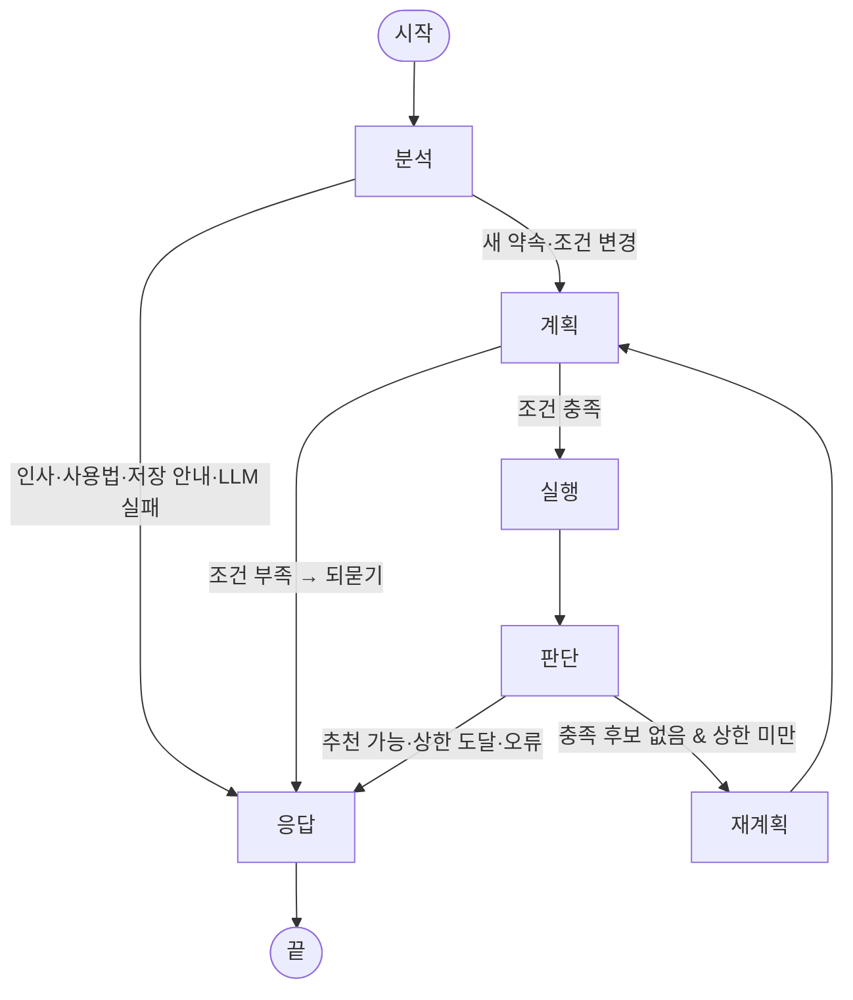

# Agent 설계 문서

약속 장소 플래너 · 구현: `backend/app/agent/`, `backend/app/events/`, `backend/app/logging_agent.py`, `backend/app/evaluation.py`

## 1. 구조 개요

```
사용자 ─(대화)→ 프론트엔드 ─→ POST /api/chat ─→ 메인 Agent (LangGraph)
                                                  │  분석 → 계획 → 실행 → 판단 → 응답 (+ 재계획 루프)
                                                  │         │ Tool 호출 (외부 API 5종)
                                                  └─ 이벤트 발행 ─→ EventBus ─→ 로깅 Agent (구독자)
                                                                          ├─ 세션별 JSONL 저장 (LLM 미사용)
                                                                          └─ 실행 종료 시 이상 징후 판정 (규칙) → 이상일 때만 LLM 진단
```

| 구성 | 역할 | LLM |
|---|---|---|
| 메인 Agent | 요청 분석 → 계획 → Tool 호출·결과 통합 → 제약 판단·재계획 → 최종 응답 | **분석, 응답 문장 생성** 2곳 |
| 이벤트 버스 | 실행 이벤트 발행/구독. 발행하는 쪽은 구독자를 알지 못함 | 미사용 |
| 로깅 Agent | 이벤트 구독, 세션별 저장, 실행 종료 시 이상 징후 판정 | 수집·저장·판정 **미사용**, 진단은 이상일 때만 |
| 저장소 | 계획(SQLite), 실행 로그(JSONL), 평가(JSON) | - |

Planner·Worker 분리(심화 F3021)는 선택하지 않았으므로 메인 Agent 는 하나의 LangGraph 그래프다.

## 2. 메인 Agent 실행 단계



실제 컴파일된 그래프 출력: [verification/agent_graph.mmd](verification/agent_graph.mmd) (노드 `analyze`, `plan`, `execute`, `judge`, `replan`, `respond`)

| 단계 | 하는 일 | LLM | 입력 → 출력 |
|---|---|---|---|
| 분석 `analyze` | 의도 분류(`new_meet`/`edit_cond`/`save_plan`/`chat`)와 조건 추출. 선택 버튼 응답은 LLM 없이 조건에 반영 | 사용 | 메시지 + Memory 맥락 → `intent`, `slots` |
| 계획 `plan` | 누락 조건 점검 후 되묻기, 아니면 Tool 호출 계획 구성 | 미사용(규칙) | `slots` → `plan`(Tool 순서) 또는 `ask` |
| 실행 `execute` | 위치 해석 → 날씨 → 후보 역 → 후보 압축 → 이동시간 → 제약 필터 → 주변 장소 | 미사용 | `slots` → `res`, `evals`, `passed`, `excl` |
| 판단 `judge` | 점수 계산·정렬, 재계획 여부 결정 | 미사용(계산식) | `passed` → `ranked`, `decision` |
| 재계획 `replan` | 검색 반경·후보 수 확대, 이벤트 발행 | 미사용 | `replan_n`, `radius_m`, `k` 갱신 |
| 응답 `respond` | 추천·근거·제외 사유를 구조화하고 요약 문장 생성(실패 시 템플릿) | 사용(문장만) | `ranked`, `excl` → `final` |

### 의도와 분기

| 의도 | 설명 | 처리 |
|---|---|---|
| `new_meet` | 새 약속 추천 요청 | 조건을 초기화하고 새로 추출 → 전체 흐름 |
| `edit_cond` | 직전 조건의 일부 변경·추가 정보 | **말한(바뀐) 조건만 갱신**하고 전체 흐름 (이미 조회한 결과는 재사용) |
| `save_plan` | "저장해줘" | 계획 단계를 건너뛰고 "추천 카드의 저장 버튼을 누르세요" 안내 (저장은 Tool 이 아니라 백엔드 API) |
| `chat` | 인사·사용법 | **계획 단계를 건너뛰고** 바로 응답 (Tool 호출 0회) |

되묻기(`ask`) 직후의 사용자 답변은 LLM 이 `new_meet` 으로 분류해도 `edit_cond`(조건 갱신)로 처리한다.

### 상태 (State)

`session_id`, `message`, `choice`, `memory`, `intent`, `reason`, `slots`, `ask`, `fatal`, `plan`, `res`, `evals`, `passed`, `excl`, `ranked`, `near`, `replan_n`, `radius_m`, `k`, `decision`, `status`, `final`, `prev_eval`

`slots` = `{ locs[], purpose, date, start, end, prio, t_max, g_max }` — **뽑지 못한 값은 `null` 로 두고 임의로 채우지 않는다.**

### 조건 분류와 되묻기

| 구분 | 조건 | 비어 있을 때 |
|---|---|---|
| 기준 | 날짜, 시작 시각, 종료 시각(선택) | 날짜·시작 시각이 없으면 Tool 호출 **전에** 되묻기. 종료 시각은 `null` 로 저장하고 겹침 판정에만 시작+3시간 사용 |
| 선호 | 위치 2~4곳, 목적, 우선순위(이동 부담 적게/할 거 많게/음식점 많게) | 위치가 2곳 미만이거나 5곳 이상이면 되묻기, 우선순위는 **선택 버튼**으로 되묻기 |
| 제약 | 최대 이동시간(기본 90분), 참여자 간 편차(기본 30분), 강수확률 60% 이상이면 실내 위주 | 기본값을 쓰고 응답에 "기본값을 썼어요"로 표기 |

그 밖의 되묻기: 위치가 여러 곳(`AMBIGUOUS` → 후보 버튼, 재계획 아님), 위치를 찾지 못함, 지난 날짜.

## 3. 제약 판단 계산식 (F3008)

1. **중심 좌표** = 참여자 좌표의 평균.
2. `find_stn(중심, 반경)` 으로 후보 역을 받고 노선별 중복을 역명으로 합친다.
3. **후보 압축**: 참여자까지 직선거리 합이 작은 상위 **K** 개 (API 호출 없음).
4. 후보마다 `get_route` 를 참여자 수만큼 호출해 이동시간 `t_i`(분)를 얻는다. **가장 먼 참여자부터** 호출하고, `t_i > T_max` 이면 그 후보의 나머지 호출을 생략한다(호출량 절감, 후보는 상한 초과로 제외).
5. **제약 필터** (경계값 포함): `max(t_i) ≤ T_max`(90) 그리고 `max(t_i) − min(t_i) ≤ G_max`(30). 경로가 없거나(NO_ROUTE) 조회에 실패한 후보는 **값을 채우지 않고 판단하지 않은 채 제외**하며 사유를 적는다.
6. **날씨**: 강수확률 ≥ 60% 이면 `관광명소` 를 일괄 제외하고 그 사실과 이유를 응답에 적는다. 예보 범위 밖·값 없음이면 날씨 판단을 생략하고 그렇게 표기한다.
7. **점수** (높을수록 좋음, 동점이면 이동시간 합 → 최대 이동시간이 작은 쪽):

   | 우선순위 | 점수 | `find_spot` 호출 |
   |---|---|---|
   | 이동 부담 적게 | `−Σ t_i` | 상위 3곳 × 4개 카테고리 (표시용) |
   | 할 거 많게 | 반경 500m 안 (음식점+카페+문화시설+관광명소) 건수 합 | 필터 통과 후보 전체 × 4개 카테고리 |
   | 음식점 많게 | 반경 500m 안 음식점 건수 | 필터 통과 후보 전체 × 음식점 |

   건수를 확인하지 못한 후보는 점수를 만들지 않고 "판정 불가"로 제외한다.
8. 점수 상위 **3곳**을 추천한다. 각 추천에는 참여자별 이동시간·환승, 최대/편차, 점수, 주변 장소, 제외 후보와 사유가 함께 담긴다.
9. 외부 API 로 확인할 수 없는 값(실제 상영·운행 시각 등)은 지어내지 않는다. 이동시간은 "조회 시점 기준"임을 항상 표기한다. 직선 500m 이하인데 대중교통 경로가 없으면 도보로 **추정**하고 그렇게 표기한다.

## 4. 계획 수립과 재계획 (F3006, F3009)

### 계획 수립

`PLAN_STEPS = [geo_loc, get_wx, find_stn, get_route, find_spot]` 를 계획으로 보관(실행 이벤트 `step_end(plan)` 에 기록)하고 이후 단계에서 참조한다. 요청 처리에 불필요한 Tool 은 계획에서 제외한다: `chat`/`save_plan` 은 **계획 단계 자체를 건너뛴다**(Tool 0회). 값 전달: 참여자 좌표 → 중심 좌표 → `find_stn`·`get_wx` / 참여자·후보 좌표 → `get_route` / 후보 좌표 → `find_spot`.

### 재계획 조건

- **재계획한다**: 제약을 충족하는 후보가 **0개**일 때. 후보 역이 아예 없는 경우(`find_stn` 의 `NO_RESULT`)를 포함한다. 이동시간·편차 상한은 **사용자의 조건이므로 임의로 바꾸지 않는다.**
- **재계획하지 않는다**: ① `NO_KEY`, `RATE_LIMIT`, `BAD_INPUT` 처럼 다시 시도해도 결과가 같은 실패 → 즉시 안내 ② 이동시간 조회가 **전부 실패**(`API_ERROR`)해 제약 불충족을 판단할 수 없는 경우 → `no_data` 로 응답 ③ 되묻기 사유(위치 모호, 조건 부족)
- **재계획 순서와 상한 (3회)**

  | 회차 | 후보 반경 | 후보 수 K |
  |---|---|---|
  | 최초 시도 | 3000m | 5 |
  | 재계획 1회 | 5000m | 5 |
  | 재계획 2회 | 8000m | 5 |
  | 재계획 3회 | 8000m | 8 |

  (K 는 대중교통 API 일일 호출 한도에 대응해 8·8·8·12 에서 5·5·5·8 로 줄였다. 요청당 `get_route` 는 최대 후보 5곳 × 참여자 2명 = 10회.)

- **재사용**: 이미 조회한 Tool 결과(성공·`NO_RESULT`·`NO_ROUTE`)는 `(Tool, 인자)` 키로 세션 메모리에 캐시하여 다시 호출하지 않고 새로 늘어난 후보만 호출한다(`cache_hit` 이벤트).
- **상한 도달 시**: 멈추고, 가장 근접했던 후보와 초과 폭(`near_miss`)을 사유로 보여 준 뒤 조건 조정을 되묻는다 (이동시간·편차 완화 버튼). 중간 지점 주변에 역이 없어서 도달한 경우에는 제약 완화가 도움이 되지 않으므로 "서로 더 가까운 위치로 알려 달라"고 안내한다(`relax_region`).
- 요청당 외부 호출 예산 100회(`CALL_BUDGET`)를 넘으면 `RATE_LIMIT` 으로 중단한다.

## 5. 이벤트와 로깅 Agent (F3012~F3014)

### 메인 Agent 와 로깅 Agent 의 관계

- 메인 Agent 는 `EventBus.publish(session_id, type, ...)` 로 **발행만** 한다. 누가 구독하는지 알지 못하며, 구독자가 없거나 구독자가 예외를 내도 정상 동작한다 (`DISABLE_LOGGING_AGENT=1` 로 검증).
- 로깅 Agent 는 버스의 구독자다. 이벤트를 받는 즉시 세션별 JSONL(`data/logs/{session_id}.jsonl`)에 **발생 순서대로 덧붙인다**. 저장 실패는 삼켜 대화에 영향을 주지 않는다. 수집·저장 코드에는 LLM 호출이 없다.
- 화면에 보여 줄 "실행 과정"은 `/api/chat` 이 요청 동안만 붙이는 별도의 임시 구독자가 만든다 (로깅 Agent 와 무관).
- 실행 로그는 **목록·상세·삭제만** 제공하고 수정 API 는 없다. Tool 응답 원문은 로그에 남기지 않는다(호출 인자·성공 여부·건수·소요 시간만).

### 이벤트

공통 필드: `session_id`, `seq`(세션 내 순번), `ts`(UTC), `type`

| type | 발행 시점 | 주요 필드 |
|---|---|---|
| `step_start` | 단계 진입 | `step` |
| `step_end` | 단계 종료 | `step`, `ms`, + 단계별: 분석 `intent`·`reason`·`prev_eval`·`prev_warnings`, 계획 `plan`·`ask`, 실행 `candidates`·`passed`·`tool_calls`, 판단 `decision`·`status`, 재계획 `n`·`radius_m`·`k`, 응답 `response_type`·`status` |
| `tool_req` | Tool 호출 요청 | `tool`, `args` |
| `tool_res` | Tool 응답 | `tool`, `ok`, `code`, `ms`, `count` (응답 원문 없음) |
| `cache_hit` | 이미 확보한 결과 재사용 | `tool` |
| `llm_decision` | LLM 이 흐름을 바꾸는 판단 | `kind`(`intent`), `value`, `reason` |
| `replan` | 재계획 시작 | `n`, `trigger`(`no_station`/`constraint_unmet`), `change` |
| `run_end` | 요청 종료 | `status`, `total_ms` |

**LLM 판단과 이유의 기록**: 분석 단계에서 LLM 이 의도를 분류하면 `llm_decision{kind=intent, value, reason}` 를 발행하고, 분석 `step_end` 에도 같은 `intent`·`reason` 을 싣는다. 선택 버튼 처리처럼 LLM 을 쓰지 않은 경우 `reason` 에 "(LLM 미사용)" 을 적는다.

### 저장 구조

- 실행 로그: 세션 단위 JSONL (한 줄 = 이벤트 1건, 실행 순서). 실행(요청) 경계는 `run_end` 이벤트.
- 계획: SQLite `plans` 테이블 (`date`, `start_time`, `end_time`, `participants`, `purpose`, `priority`, `station`, `spot`, `created_at`, `updated_at`).
- 평가: `data/evals/{session_id}.json` (실행 순서 리스트, 로그와 분리).

## 6. 로깅 Agent 평가 — 이상 징후 판단 (심화 F3020)

실행(요청 1건)이 끝나면(`run_end`) 로깅 Agent 가 그 실행의 이벤트만 모아 판정한다.

| 규칙 | 경고 조건 |
|---|---|
| `repeated_call` 반복 호출 | 같은 Tool 이 같은 입력(키 순서 무관)으로 한 실행에서 2회 이상 호출 |
| `excess_replan` 재계획 과다 | 재계획이 상한(`MAX_REPLAN`=3)에 도달 |
| `unplanned_call` 계획 외 호출 | 계획 단계가 정한 Tool 목록에 없는 Tool 호출 (계획 없이 호출한 경우 포함) |

- **판정은 LLM 없이** 이벤트를 대조하고 횟수를 센다. 결과는 `ok` / `anomaly` / `unknown`. 실행 시작(`analyze`)을 관찰하지 못한 것처럼 **근거가 되는 이벤트가 없으면 '이상 없음'이 아니라 `unknown`(판정 불가)** 으로 남긴다.
- **원인 진단은 `anomaly` 인 실행에만** LLM 이 수행한다 (경고·실행 기록 요약을 읽고 세 문장 이내: 어느 쪽 문제인지, 무엇을 고칠지). 정상·판정 불가 실행에는 LLM 을 호출하지 않는다. 진단은 `diagnosis` 필드에 판정과 **구분해** 저장하고 `warning_count` 에 섞지 않는다. 백그라운드로 실행되어 응답을 지연시키지 않으며, 실패해도 판정과 로그는 그대로 남는다(`status=failed`).
- **메인 Agent 가 참조할 수 있는 형식**: 판정은 `{verdict, warnings[{code,message,evidence}], checks, stats, diagnosis}` dict 로 저장되며 `GET /api/logs/{id}/evaluations`, `/api/chat` 응답의 `evaluation`, 그리고 메인 Agent 의 `eval_lookup`(직전 실행 판정 조회 함수)으로 읽을 수 있다. 메인 Agent 는 요청 시작 시 직전 판정을 조회해 분석 단계 종료 이벤트에 `prev_eval`·`prev_warnings` 로 기록한다. **현재는 참조·기록만 하며 흐름을 바꾸지는 않는다** (이상 판정 시 Planner 가 작업 목록을 다시 구성하는 것은 심화 F3021 범위로 구현하지 않음).
- **검증용 이상 주입**: 반복 호출·계획 외 호출·근거 없음은 운영 중 저절로 생기지 않으므로, 실제 서버에서 이상 실행을 *각각 만들어* 확인하기 위해 환경변수 `ANOMALY_INJECT` 를 둔다(Tool 실패 주입 `FAIL_INJECT` 와 같은 성격, **운영에서는 비워 둠**). `repeat_call`: `get_wx` 를 같은 입력으로 한 번 더 호출(캐시 우회), `unplanned_call`: 계획에서 `get_wx` 를 빼고 실행은 그대로 호출, `missing_events`: 실행 시작(`analyze` 단계 시작) 이벤트를 발행하지 않아 유실을 재현. 실제 실행 결과는 [05_검증결과.md](05_검증결과.md) 4.6.
- **한계**: '재계획 과다'를 상한 도달로 정의했기 때문에, 사용자 조건이 현실적으로 충족 불가능한 요청(예: 수원+춘천)도 `anomaly` 로 판정된다. LLM 진단 프롬프트가 이 경우를 "Agent 결함이 아니라 사용자 조건 문제"로 구분하도록 기준을 주었다 (실측 진단: [samples/S3_evaluations.json](samples/S3_evaluations.json)).

## 7. 대화 맥락 (Memory) (F3010)

세션 id 별 프로세스 메모리(`SessionMemory`)에 보관한다. **DB 에는 쓰지 않는다.**

| 구분 | 내용 |
|---|---|
| 보관 | 조건(`slots`), 해석한 위치 좌표(`geo`), 직전 추천 요약(역명·최대·편차·점수·제외 수), 되묻기 상태(`pending`), 재사용할 Tool 결과 캐시(정규화된 값: 이름·분·건수) |
| 보관하지 않음 | Tool 원본 응답(카카오 약관), 중간 판단 전문 |
| 갱신 | `new_meet` → 조건 초기화 후 새로 추출. `edit_cond` → **사용자가 말한 값만** 덮어씀(나머지 유지). 위치·날짜가 바뀌면 `(Tool, 인자)` 키가 달라져 관련 결과(경로·장소·날씨)는 자연히 재조회되고, 우선순위만 바뀌면 이동시간을 다시 부르지 않는다 |
| 한계 | 서버를 재시작하면 대화 맥락이 사라진다 |

## 8. LLM 호출 조건 정리

| 주체 | 호출하는 조건 | 호출하지 않는 조건 |
|---|---|---|
| 메인 Agent 분석 | 사용자 메시지를 받을 때마다 (모델: GPT `gpt-4o-mini`, 온도 0, JSON 출력) | 선택 버튼 응답 |
| 메인 Agent 응답 | 추천/상한 도달 결과의 요약 문장, 인사·사용법 답변 (실패하면 템플릿 문장으로 대체) | 되묻기, 오류 안내(고정 문구) |
| 계획·실행·판단 | **호출하지 않음** (규칙·계산식) | 항상 |
| 로깅 Agent 수집·저장·판정 | **호출하지 않음** | 항상 |
| 로깅 Agent 진단 | `verdict=anomaly` 인 실행에만 | 정상(`ok`)·판정 불가(`unknown`) 실행 |

모델이 출력한 날짜·시각 형식이 틀리면 지어내지 않고 비워 되묻는다. 날짜 언급이 없는데 오늘 날짜를 채운 경우는 코드에서 제거한다(`drop_unsupported_today`).

## 9. 설정값 (`backend/app/config.py`, 환경변수로 조정)

| 설정 | 기본값 | 의미 |
|---|---|---|
| `T_MAX` / `G_MAX` | 90 / 30 | 최대 이동시간 / 참여자 간 편차 상한 (분) |
| 반경·후보 수 | 3000→5000→8000→8000 / 5→5→5→8 (측정 당시 8→8→8→12) | 재계획 단계별 |
| `MAX_REPLAN` | 3 | 재계획 상한 |
| `RAIN_THRESHOLD` | 60 | 이 이상이면 실내 위주 (%) |
| `DEFAULT_STAY_H` | 3 | 종료 시각이 없을 때 겹침 판정용 체류 시간 |
| `MAX_PARTICIPANTS` | 4 | 최대 참여자 수 |
| `CALL_BUDGET` | 100 | 요청당 외부 호출 상한 |
| `WX_MAX_DAYS` | 14 | 예보 가능 일수 |
