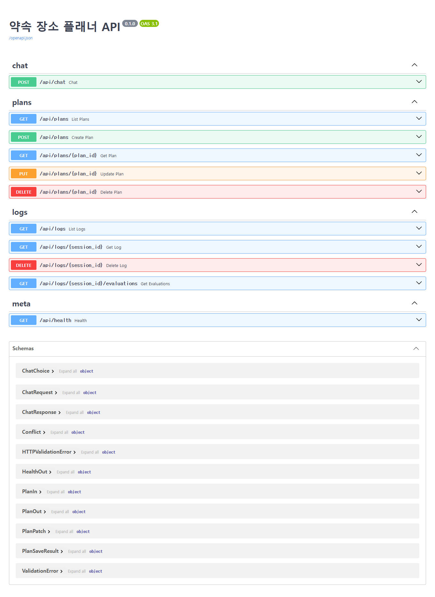

# API 명세서

약속 장소 플래너 백엔드 · FastAPI · 기본 주소 `http://localhost:8000` · 자동 문서 `/docs` · 스키마 [openapi.json](openapi.json)



- 대화 요청(`/api/chat`), 계획 관리(`/api/plans`), 실행 로그 조회(`/api/logs`)는 서로 다른 경로이며, 요청·응답은 Pydantic 모델로 정의한다 (`backend/app/schemas.py`).
- **실행 로그는 목록·상세·삭제만 있고 수정 API 는 없다** (`PUT`/`PATCH`/`POST` 는 405). 평가(판정)도 조회만 가능하다.
- 시각(`created_at`, 로그의 `ts`)은 UTC ISO 8601 이며, 화면에서 한국 시각으로 변환해 표시한다.

## 1. 요약

| 메서드 | 경로 | 설명 | 성공 |
|---|---|---|---|
| POST | `/api/chat` | 대화 요청 (분석→계획→실행→판단→응답) | 200 |
| GET | `/api/plans` | 계획 목록 | 200 |
| POST | `/api/plans` | 계획 저장 (겹치면 `conflicts` 로 알림, 저장은 막지 않음) | 201 |
| GET | `/api/plans/{plan_id}` | 계획 상세 | 200 / 404 |
| PUT | `/api/plans/{plan_id}` | 계획 수정 (보낸 필드만 갱신) | 200 / 404 / 422 |
| DELETE | `/api/plans/{plan_id}` | 계획 삭제 | 204 / 404 |
| GET | `/api/logs` | 실행 로그 세션 목록 (+ 판정 요약) | 200 |
| GET | `/api/logs/{session_id}` | 세션 상세 (이벤트를 실행 순서대로) | 200 / 404 |
| DELETE | `/api/logs/{session_id}` | 세션 로그 삭제 (평가 결과도 함께 삭제) | 204 / 404 |
| GET | `/api/logs/{session_id}/evaluations` | 실행별 이상 징후 판정·진단 (F3020, 읽기 전용) | 200 / 404 |
| GET | `/api/health` | 설정 여부(키 **값**은 노출하지 않음) | 200 |

## 2. 대화 `POST /api/chat`

### 요청 `ChatRequest`

```json
{ "session_id": "ec3a…(선택, 8~64자 영숫자·_-)", "message": "잠실이랑 건대 사는 둘이 토요일 오후 2시에 데이트, 할 거 많은 곳으로",
  "choice": null }
```

| 필드 | 타입 | 설명 |
|---|---|---|
| `session_id` | string? | 없으면 서버가 발급한다. 같은 값을 보내면 대화 맥락(Memory)이 이어진다 |
| `message` | string | 최대 500자. `choice` 가 있으면 비워도 된다 |
| `choice` | object? | 되묻기의 선택 버튼 응답 `{ "kind": "priority"｜"disambiguate"｜"patch", "value": …, "name": … }` |

`choice` 종류: `priority`(value=`travel`/`things`/`food`), `disambiguate`(value=선택한 후보 `{id,name,addr,x,y}`, name=원래 입력한 위치 이름), `patch`(value=`{"t_max": 120}` 같은 제약 완화). 선택 버튼 처리에는 LLM 을 쓰지 않는다.

### 응답 `ChatResponse`

| 필드 | 설명 |
|---|---|
| `session_id` | 세션 id |
| `type` | `answer`(응답) / `ask`(되묻기) / `error`(오류 안내) |
| `status` | `ok`(추천) / `chat`(Tool 불필요) / `ask` / `limit`(재계획 상한) / `no_data`(조회 실패로 판정 불가) / `error` |
| `answer` | 사용자에게 보여 줄 문장 |
| `ask` | 되묻기일 때 `{ kind, message, choices[{label,value}], name? }`. `kind`: `missing`(조건 부족) / `priority`(우선순위 선택) / `disambiguate`(위치 모호) / `relax`(제약 완화) / `relax_region`(지역 조정 권유) |
| `result` | 추천 결과 (아래) 또는 `null` |
| `error_code` | `type=error` 일 때: `NO_KEY` `RATE_LIMIT` `UPSTREAM` `LLM_NO_KEY` `LLM_ERROR` `INTERNAL` |
| `timeline` | 이번 요청의 실행 이벤트 목록 (단계·Tool 호출·재계획, 화면의 "실행 과정" 표시용) |
| `evaluation` | 로깅 Agent 의 이번 실행 판정 (로깅 Agent 가 꺼져 있으면 `null`) |

`result` 구조 (실제 응답에서 발췌):

```json
{
  "date": "2026-11-21", "date_note": "2026-11-21(토)", "replans": 0,
  "criteria": { "t_max": 90, "g_max": 30, "prio": "things", "prio_label": "할 거 많게", "rain_threshold": 60, "defaults_used": ["t_max", "g_max"] },
  "weather": { "rain_pct": 0, "tmax": 0.5, "tmin": -5.4, "rainy": false },
  "recommendations": [
    { "rank": 1, "station": "건대입구역", "x": 127.07, "y": 37.54,
      "times": [ { "name": "잠실", "min": 13, "transfers": 0, "walk": false }, { "name": "건대", "min": 6, "transfers": 0, "walk": false } ],
      "max_t": 13, "min_t": 6, "gap": 7, "sum_t": 19, "score": 861.0,
      "spots": { "음식점": { "total": 667, "items": [ { "name": "…", "addr": "…", "url": "https://…", "dist_m": 5 } ] } } }
  ],
  "excluded": [ { "name": "자양역", "reason": "경로를 찾지 못해 판단하지 않음 (NO_ROUTE)" } ],
  "near_miss": null,
  "notes": [ "이동시간은 조회 시점 기준이며 약속 시각의 실제 운행과 다를 수 있어요." ],
  "plan_draft": { "date": "2026-11-21", "start_time": "14:00", "end_time": null, "participants": ["잠실", "건대"], "purpose": "데이트", "priority": "things" }
}
```

`plan_draft` 는 계획 저장 시 그대로 `POST /api/plans` 본문의 기본값으로 쓴다 (사용자가 말하지 않은 종료 시각은 `null`).

### 오류

| 상황 | 응답 |
|---|---|
| `message`·`choice` 모두 없음 / 500자 초과 / `session_id` 형식 오류 | 422 (FastAPI 검증 오류) |
| 외부 API 키 없음, LLM 실패 등 | 200, `type="error"` + 사용자용 안내문 (키 값·내부 오류 상세는 노출하지 않음) |
| 처리되지 않은 서버 예외 | 500 `{"error_code": "INTERNAL", "message": "서버 내부 오류가 발생했습니다."}` |

## 3. 계획 관리 `/api/plans`

### `PlanIn` (POST 요청) / `PlanOut` (응답)

| 필드 | 타입 | 필수 | 설명 |
|---|---|---|---|
| `date` | string | ✔ | `YYYY-MM-DD` |
| `start_time` | string | ✔ | `HH:MM` |
| `end_time` | string? | | `HH:MM`, 시작보다 늦어야 함. 비워 두면 `null` (겹침 판정에서만 시작+3시간 사용) |
| `participants` | string[] | ✔ | 1~8 개 |
| `purpose` | string? | | 목적 |
| `priority` | string? | | `travel` / `things` / `food` |
| `station` | string | ✔ | 만남 역 |
| `spot` | string? | | 선택 장소 (사용자가 고른 이름) |
| `id`, `created_at`, `updated_at` | | (응답) | `PlanOut` 에만 있음 |

좌표·주소·URL 은 저장하지 않는다 (카카오 응답 저장 금지 약관).

### `POST /api/plans` → 201 `PlanSaveResult`

```json
{ "plan": { "id": 2, "date": "2026-11-21", "start_time": "14:00", "end_time": null, "participants": ["잠실", "건대"],
            "purpose": "데이트", "priority": "food", "station": "잠실새내역", "spot": null,
            "created_at": "2026-11-19T15:15:20+00:00", "updated_at": "2026-11-19T15:15:20+00:00" },
  "conflicts": [ { "id": 1, "date": "2026-11-21", "start_time": "14:00", "end_time": null, "station": "건대입구역" } ] }
```

같은 날짜에 시간이 겹치는 계획이 있어도 **저장은 하고** 겹치는 계획을 `conflicts` 로 알린다. 겹침 = `시작 < 상대 종료 and 종료 > 상대 시작` (맞닿는 경계는 겹침 아님).

### `PUT /api/plans/{id}` — `PlanPatch`

보낸 필드만 수정한다 (`date`, `start_time`, `end_time`, `participants`, `purpose`, `priority`, `station`, `spot`). 응답은 `PlanSaveResult` (수정 후 겹침도 다시 계산). 형식·시각 순서 오류는 422.

### `GET /api/plans` → `PlanOut[]` (날짜·시작 시각순) · `GET /api/plans/{id}` → `PlanOut` · `DELETE /api/plans/{id}` → 204

## 4. 실행 로그 `/api/logs`

### `GET /api/logs`

```json
[ { "session_id": "2369…", "started_at": "2026-11-19T15:15:59.9+00:00", "last_at": "2026-11-19T15:16:12.4+00:00",
    "event_count": 118, "runs": 2, "last_status": "ok", "replans": 4,
    "latest_verdict": "ok", "anomaly_runs": 1, "evaluated_runs": 2 } ]
```

최근 활동순. `runs` = 요청(실행) 수, `replans` = 재계획 이벤트 수, `latest_verdict`/`anomaly_runs` = 평가 요약.

### `GET /api/logs/{session_id}` → 이벤트를 실행(저장) 순서대로

```json
{ "session_id": "…", "events": [
  { "session_id": "…", "seq": 1, "ts": "2026-11-19T15:15:11.143+00:00", "type": "step_start", "step": "analyze" },
  { "session_id": "…", "seq": 2, "ts": "…", "type": "llm_decision", "kind": "intent", "value": "new_meet", "reason": "…" },
  { "session_id": "…", "seq": 8, "ts": "…", "type": "tool_req", "tool": "geo_loc", "args": { "q": "잠실" } },
  { "session_id": "…", "seq": 9, "ts": "…", "type": "tool_res", "tool": "geo_loc", "ok": true, "code": null, "ms": 84, "count": 1 } ] }
```

이벤트 종류와 필드는 [02_Agent설계문서.md](02_Agent설계문서.md) 5장. 로그에는 호출 인자·성공 여부·건수·소요 시간만 남고 **Tool 응답 원문은 없다**.

### `DELETE /api/logs/{session_id}` → 204 (해당 세션의 평가도 함께 삭제)

### `GET /api/logs/{session_id}/evaluations` — F3020

```json
{ "session_id": "…", "evaluations": [ {
  "run_index": 1, "evaluated_at": "2026-11-19T15:16:02+00:00",
  "verdict": "anomaly", "basis": true, "warning_count": 1,
  "warnings": [ { "code": "excess_replan", "severity": "warn", "message": "재계획 3회 (상한 3회 도달)",
                  "evidence": { "replans": 3, "limit": 3, "changes": ["반경 3000m→5000m, 후보 수 5→5", "…"] } } ],
  "checks": { "repeated_call": "ok", "excess_replan": "warn", "unplanned_call": "ok" },
  "stats": { "tool_calls": 11, "replans": 3, "total_ms": 9084, "event_count": 73 },
  "diagnosis": { "status": "done", "text": "(LLM 원인 진단, 세 문장 이내)" } } ] }
```

- `verdict`: `ok` / `anomaly` / `unknown`(**판정 불가** — 근거 이벤트가 없음). `checks` 값: `ok` / `warn` / `na`.
- `diagnosis.status`: `skipped`(이상이 아니라 LLM 미호출) / `pending` / `done` / `failed`. 진단은 판정과 별개로 저장되며 `warning_count` 에 포함되지 않는다.

## 5. 상태 확인 `GET /api/health`

```json
{ "status": "ok", "kakao_key": true, "llm_key": true, "route_provider": "kakao", "logging_agent": true }
```

키 **값**은 반환하지 않고 설정 여부만 알려 준다. 프론트엔드가 설정 안내 배너를 표시하는 데 쓴다.

## 6. 공통

- CORS: `http://localhost:5500`, `http://127.0.0.1:5500` (프론트엔드 개발 서버)
- 세션 id 는 로그·평가 파일 이름에 쓰이므로 `^[A-Za-z0-9_-]{8,64}$` 만 허용한다 (경로 조작 방지).
- 화면에는 API 키와 오류 상세 내용을 그대로 노출하지 않는다 (`NO_KEY` 등은 코드에 대응하는 안내문으로 변환).
