# 검증 결과

명세서 4장의 확인 항목을 **실제 서버·실제 외부 API(카카오 로컬·카카오맵 대중교통·Open-Meteo)·실제 LLM(Gemini — 이후 GPT 로 전환, 재실행 필요)** 으로 실행해 확인한 결과다. 단위·통합 테스트(가짜 외부 API 사용) 119개도 통과했다 ([verification/pytest_output.txt](verification/pytest_output.txt)).

| 항목 | 내용 |
|---|---|
| 검증 방법 | `scripts/capture_evidence.py` 가 서버를 상황별로(정상 / Tool 실패 주입 / 카카오 키 없음 / 로깅 Agent 끔) 띄우고 Chrome 으로 화면을 조작해 스크린샷·기록을 저장 |
| 실행 기준일 | 2026-11-20 (약속 날짜는 "토요일" → 2026-11-21) |
| 이동시간 | 실제 카카오맵 대중교통 (`ROUTE_PROVIDER=kakao`) — 모의값 사용 안 함 |
| 원본 기록 | [verification/records.json](verification/records.json) (요청별 응답·Tool 호출·재계획·판정), [samples/](samples/) (실행 로그), [screenshots/](screenshots/) |
| 주의 | 이동시간·장소 수는 **실시간 데이터**라 재실행하면 값이 달라질 수 있다. 아래 값은 수집 시점의 결과다 |

## 4.1 Tool 확인 (F3001~F3004)

`python scripts/verify_tools.py` 로 실제 API 를 호출해 Tool 별 정상·실패 23건을 실행했고, **모든 호출이 예외 없이 `ok`/`error(code,message)` 형식으로 반환**됐다. 전체 표: [verification/tool_checks.md](verification/tool_checks.md)

| 확인 항목 | 결과 | 증빙 |
|---|---|---|
| 등록 Tool 의 이름·설명·입력 스키마 목록이 명세와 일치 | ✔ 5개 (geo_loc, find_stn, get_route, find_spot, get_wx) | tool_checks.md 상단 |
| 정상 호출과 실패 호출(잘못된 입력, API 키 없음 등)이 예외 없이 실패 형식으로 반환 | ✔ `BAD_INPUT`, `NO_KEY`, `NO_RESULT`, `NO_ROUTE`, `AMBIGUOUS`, `OUT_OF_RANGE` 모두 확인 | tool_checks.md |
| 후보 목록 Tool 에 기준을 주지 않았을 때 기본값 적용 | ✔ `find_stn` 반경 미지정 → `basis: 중심 좌표 반경 3000m` | tool_checks.md |
| 요청한 기준과 실제 조회 기준이 다를 때 밝힘 | ✔ `get_route` 는 항상 "조회 시점 기준", 도보 추정은 `basis`·`notes` 로 표기, 반경 보정은 `notes` | tool_checks.md, 3장 Tool 정의서 |
| 후보 Tool 이 반환한 식별자(좌표)를 다음 Tool 에 넘겨 조회가 이어짐 | ✔ `find_stn` 이 돌려준 역 좌표를 `get_route.to` 로 사용해 성공 (12분) | tool_checks.md, 4.2 S1 로그 |
| 판단에 필요한 속성이 비어 있는 항목이 임의 값으로 채워지지 않고 판단하지 않은 채 남음 | ✔ 경로 없음(`NO_ROUTE`) 후보는 값 없이 제외되고 사유 표기 (S4) | 4.7 S4, 화면 07 |
| 보조 정보 검색 Tool 에서 결과가 없을 때 정의한 응답 형식 | ✔ `find_spot` 외진 좌표 → `NO_RESULT`, Agent 는 개수 0 으로 점수 반영 | tool_checks.md |

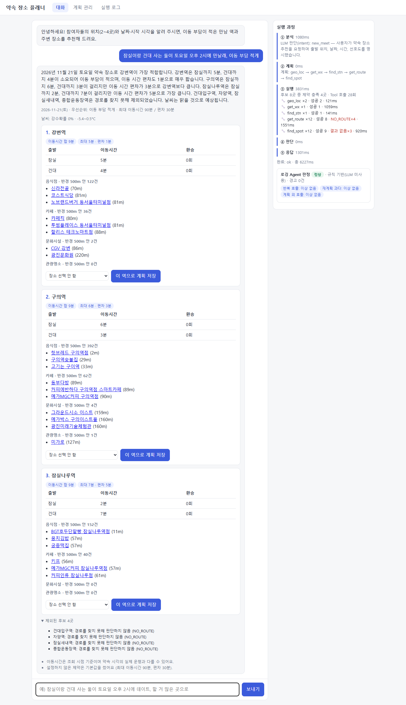

## 4.2 메인 Agent 실행 흐름 확인 (F3005~F3011)

### 조건 추출과 임의 채움 방지 (F3005)

실제 LLM 으로 요청 5개의 분석 결과를 출력했다 ([verification/analysis_outputs.md](verification/analysis_outputs.md), `python scripts/show_analysis.py`). 요청에 없는 값은 `null` 로 남고 임의로 채워지지 않았다.

| 케이스 | 요청 | intent | locs | purpose | date | start | end | prio | t_max | g_max |
|---|---|---|---|---|---|---|---|---|---|---|
| 기준·선호가 모두 있는 요청 | 잠실이랑 건대 사는 둘이 토요일 오후 2시에 데이트, 할 거 많은 곳으로 | `new_meet` | `['잠실', '건대']` | `데이트` | `2026-11-21` | `14:00` | `null` | `things` | `null` | `null` |
| 제약(이동시간 상한)이 있는 요청 | 수원이랑 의정부 사는 둘이 내일 저녁 7시에 만날래, 이동은 60분 넘지 않게 | `new_meet` | `['수원', '의정부']` | `null` | `2026-11-21` | `19:00` | `null` | `travel` | `60` | `null` |
| 날짜·시작 시각이 없는 요청 (임의로 채우면 안 됨) | 송도랑 마석에서 모일 장소 추천해줘 | `new_meet` | `['송도', '마석']` | `null` | `null` | `null` | `null` | `null` | `null` | `null` |
| 종료 시각만 있는 요청 (시작 시각을 지어내면 안 됨) | 잠실에서 7시 전에 끝나야 해 | `edit_cond` | `null` | `null` | `null` | `null` | `19:00` | `null` | `null` | `null` |
| Tool 이 필요 없는 요청 | 안녕 | `chat` | `null` | `null` | `null` | `null` | `null` | `null` | `null` | `null` |

관찰: 2번째 요청에서 우선순위를 말하지 않았지만 모델이 "이동은 60분 넘지 않게"를 **이동 부담 적게**로 해석했다(말한 제약 표현에서의 추론이며 임의 기본값은 아님). 날짜·시각이 없는 요청(3·4번째)은 비워 두고 되물었다 (화면 10, 11).

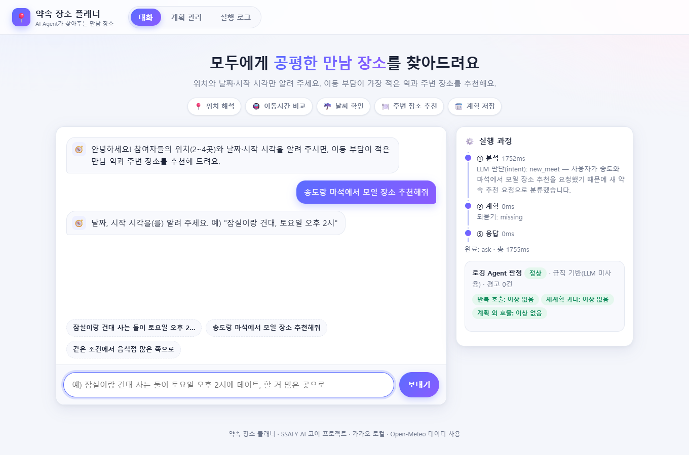

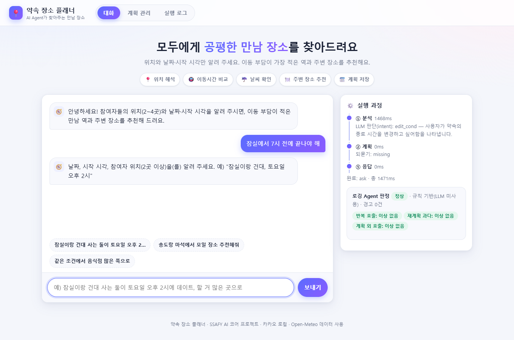

### LangGraph 그래프 구조

분석 → 계획 → 실행 → 판단 → 응답 노드로 구성되고, 판단에서 재계획 노드를 거쳐 계획으로 돌아가는 루프가 있다 (`python scripts/show_graph.py`, 원본 [verification/agent_graph.mmd](verification/agent_graph.mmd)).

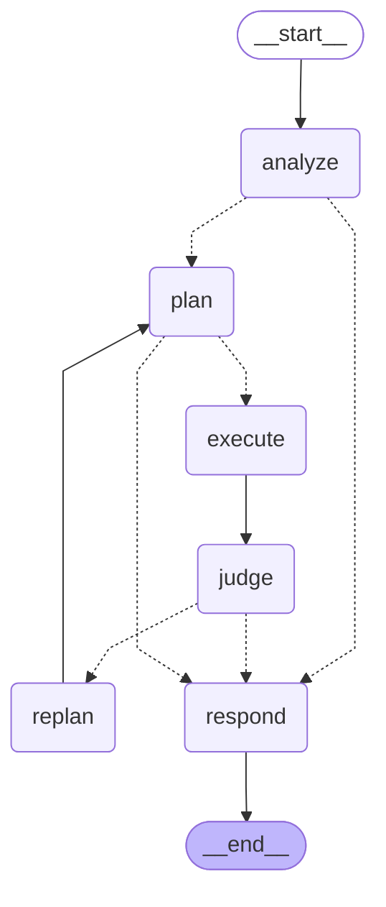

### Tool 이 필요한 요청과 필요 없는 요청의 계획 (F3006)

| 요청 | 실행 단계 | Tool 호출 |
|---|---|---|
| S1 `잠실이랑 건대 사는 둘이 토요일 오후 2시에 데이트, …` | analyze → plan → execute → judge → respond | geo_loc ×2, get_wx ×1, find_stn ×1, get_route ×16, find_spot ×32 (실패/결과없음: find_spot:NO_RESULT×5) |
| S5 `안녕` | analyze → respond (**계획 단계 건너뜀**) | 없음 |

### 값 전달과 Tool 실패 시 진행 (F3007)

S1 로그에서 `find_stn` 이 돌려준 후보 좌표가 `get_route` 입력으로, 그 결과 후보 좌표가 `find_spot` 입력으로 전달됐다 ([samples/S1_full_run_log.md](samples/S1_full_run_log.md)). `get_route` 를 일부러 실패시킨 S4 에서는 호출 12회 중 4회가 `NO_ROUTE` 였지만 **나머지 단계가 진행**되어 3곳을 추천하고 4곳을 사유와 함께 제외했다.

### 제약 판단 계산 값과 응답의 일치 (F3008)

S1 1위 건대입구역: 잠실 13분, 건대 6분 → 최대 13분 ≤ 상한 90분, 편차 7분 ≤ 상한 30분 → 충족. 응답 카드의 "최대 13분 · 편차 7분" 과 점수(주변 장소 수 합 863건)가 계산 값과 일치한다. 제약 경계값(상한과 같은 값은 충족, 1분 초과는 제외)은 단위 테스트로 확인했다 (`tests/test_agent.py::test_constraint_boundaries_inclusive`).

외부 API 로 확인할 수 없는 값(약속 시각의 실제 운행 등)은 지어내지 않고 **"조회 시점 기준"** 임을 모든 응답에 표기한다. (영화 도메인의 '상영 시작 시각 역산'에 해당하는 값이 이 도메인에는 없다.)

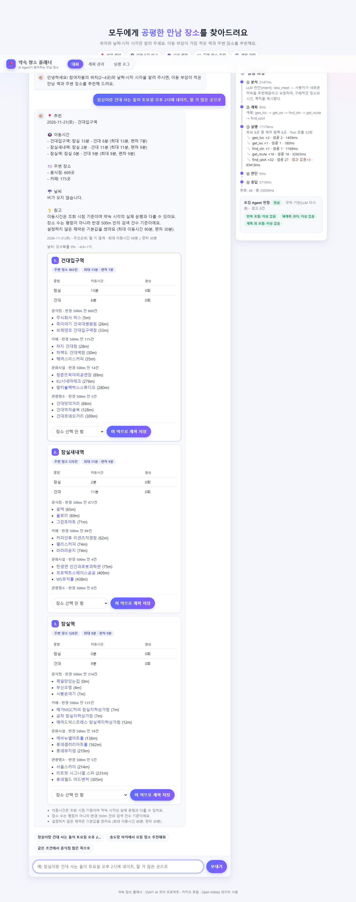

### 재계획: 결과 재사용과 상한 (F3009)

- **재사용**: S2 에서 재계획 후 이미 확보한 결과 1건을 재호출하지 않고 재사용 (화면의 ♻ 표시). S3 에서는 재사용 10건.
- **상한**: S3(수원+춘천)가 재계획 3회에서 멈추고 사유(가장 근접했던 후보 운길산역 최소 91분 이상, 초과 1분)와 함께 조건 조정을 되물었다.

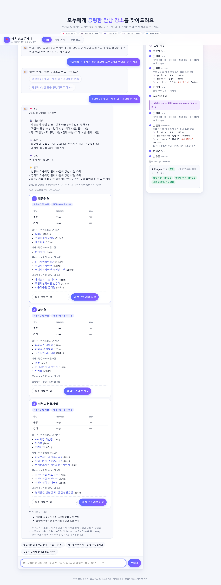

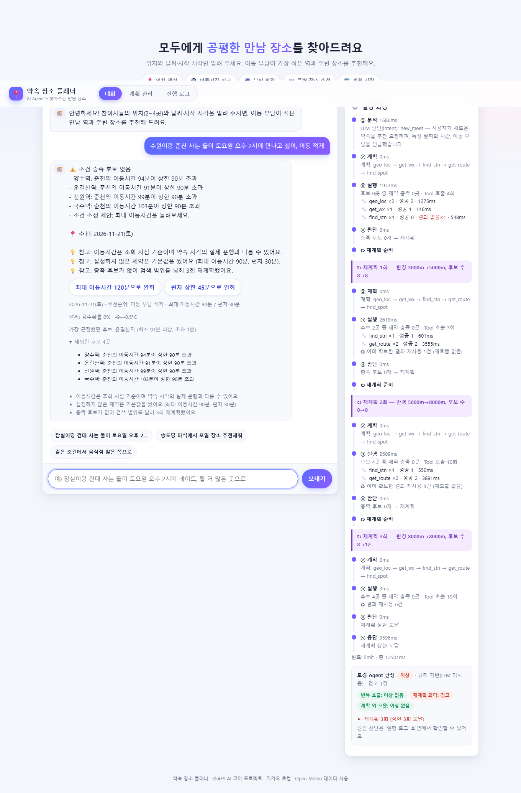

### 후속 요청에서 바뀐 조건만 갱신 (F3010)

"같은 조건에서 음식점 많은 쪽으로" → Tool 호출 **0회**, 캐시 재사용 50건, 위치(잠실·건대)·날짜·시각은 유지됐다. 다만 GPT 첫 실행에서는 우선순위가 `할 거 많게` 로 남아 `음식점 많게` 로 갱신되지 않았다(아래 화면은 이 수정 전 실행). 원인은 분석 단계에서 모델이 우선순위를 비운 것이라 분석 프롬프트에 우선순위 표현 매핑을 추가했고(커밋 17e3847), 수정 후 같은 대화 8회 모두 `음식점 많게` 로 반영됐다. 수정 직후 카카오맵 대중교통 API 가 HTTP 400 을 반환해 수정 후 화면은 다시 찍지 못했다.

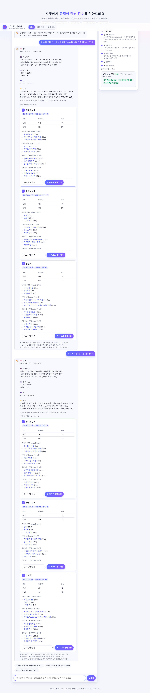

### 응답 구성 (F3011)

추천 항목(역), 보조 정보(주변 장소와 링크), 판단 기준(최대 이동시간·편차·우선순위·날씨), 근거 Tool 결과(실행 과정 패널), 제외 후보와 사유가 함께 표시된다 (화면 02, 07, 05b). 이 도메인은 위험 도메인이 아니므로 전문가 조언 안내는 해당 없음.

## 4.3 로깅 Agent 와 실행 로그 확인 (F3012~F3014)

### 이벤트 발행·LLM 판단 기록·세션 저장

대표 요청 S1 한 건의 실행 로그를 단계별로 요약했다. 전체 이벤트 116건: [samples/S1_full_run_log.md](samples/S1_full_run_log.md) (원본 [JSONL](samples/S1_full_run_log.jsonl))

| 순서 | 단계 | 소요 | Tool 호출 | 비고 |
|---|---|---|---|---|
| 1 | analyze | 2147ms | - | LLM 판단 `new_meet` |
| 2 | plan | 0ms | - | 계획=['geo_loc', 'get_wx', 'find_stn', 'get_route', 'find_spot'] |
| 3 | execute | 17176ms | geo_loc ×2, get_wx ×1, find_stn ×1, get_route ×16, find_spot ×32(실패 5) | 후보=8 · 충족=8 |
| 4 | judge | 0ms | - | 결정=respond |
| 5 | respond | 3710ms | - | - |

- 단계 진입·종료(`step_start`/`step_end`), Tool 호출 요청·응답·소요 시간(`tool_req`/`tool_res`), 재계획(`replan`), 결과 재사용(`cache_hit`), 요청 종료(`run_end`)가 모두 발행됐다.
- **LLM 이 내린 판단과 이유**가 이벤트에 남는다: `llm_decision {kind: intent, value: new_meet, reason: "사용자가 새로운 약속을 추천해달라고 요청하며, 구체적인 장소와 시간, 목적을 제시했다."}`
- `tool_res` 에는 성공 여부·코드·소요 시간·건수만 있고 **응답 원문은 없다**.

### 재계획이 발생한 실행 로그

S2(재계획 1회) 전체 로그: [samples/S2_replan_run_log.md](samples/S2_replan_run_log.md) · S3(상한 도달): [samples/S3_limit_run_log.md](samples/S3_limit_run_log.md)

| 순서 | 단계 | 소요 | Tool 호출 | 비고 |
|---|---|---|---|---|
| 1 | analyze | 0ms | - | - |
| 2 | plan | 0ms | - | 계획=['geo_loc', 'get_wx', 'find_stn', 'get_route', 'find_spot'] |
| 3 | execute | 1278ms | geo_loc ×1, get_wx ×1, find_stn ×1(실패 1) | 후보=0 · 충족=0 |
| 4 | judge | 0ms | - | 결정=replan |
| 5 | replan | 0ms | - | **재계획 1회**: 반경 3000m→5000m, 후보 수 8→8 |
| 6 | plan | 0ms | - | 계획=['geo_loc', 'get_wx', 'find_stn', 'get_route', 'find_spot'] |
| 7 | execute | 10002ms | find_stn ×1, get_route ×16, find_spot ×12(실패 2), 재사용 1 | 후보=8 · 충족=6 |
| 8 | judge | 0ms | - | 결정=respond |
| 9 | respond | 4868ms | - | - |

### 로깅 Agent 는 LLM 을 호출하지 않는다

- 수집·저장 코드(`backend/app/logging_agent.py`)에 LLM 호출이 없다. 테스트 `test_logging_agent_makes_no_llm_calls` 로 확인 (정상 실행에서 LLM 호출은 메인 Agent 의 분석 1회·응답 1회뿐, 진단 호출 0회).

### 로깅 Agent 를 연결하지 않아도 메인 Agent 정상 (S11)

`DISABLE_LOGGING_AGENT=1` 로 서버를 띄워 S1 요청을 실행: 결과 `answer/ok`, 추천 3곳 정상. `/api/health` → `logging_agent: false`, `/api/logs` → `[]` (저장 없음). 화면에 "로깅 Agent 가 꺼져 있어 실행 로그가 저장되지 않아요" 배너가 표시된다.

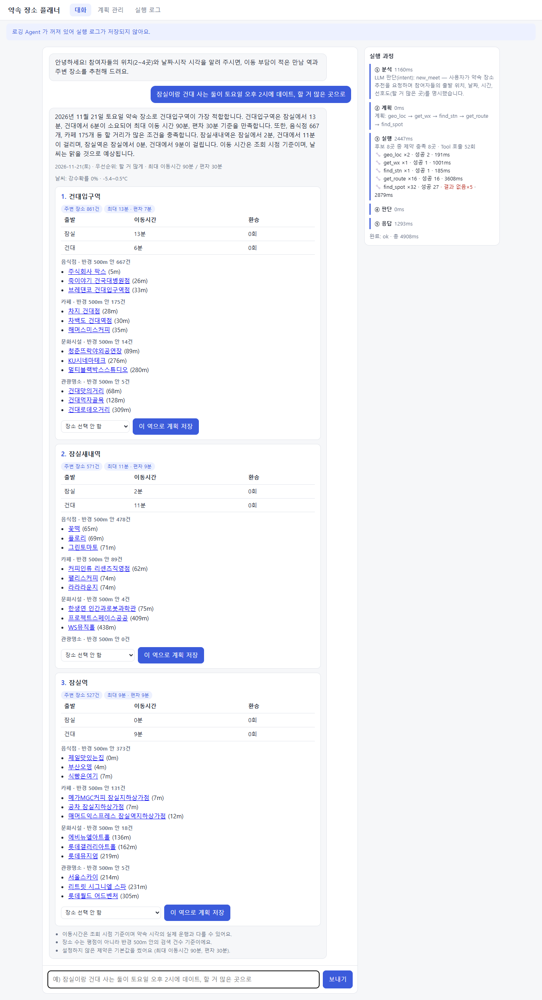

### 세션 단위 분리, 목록·상세·삭제, 수정 API 없음

- 세션별 파일(`{session_id}.jsonl`)에 저장되어 서로 다른 세션의 로그가 섞이지 않는다 (테스트 `test_logs_are_isolated_per_session_and_in_order`).
- 목록(화면 16), 상세(실행 순서, 화면 17·18), 삭제(화면 19)가 동작한다. 수정 API 는 없다: `PUT/PATCH/POST /api/logs/{id}` → 405 (테스트 `test_logs_api_list_detail_delete_and_no_update`, API 문서 화면 20 에 GET·DELETE 만 존재).

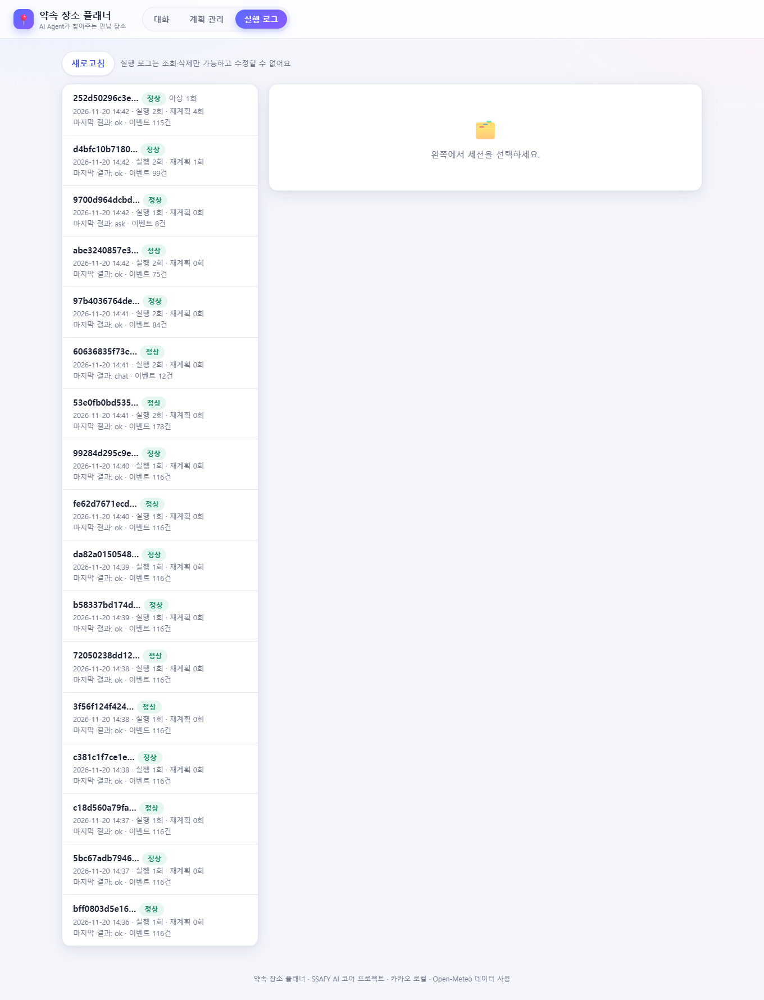

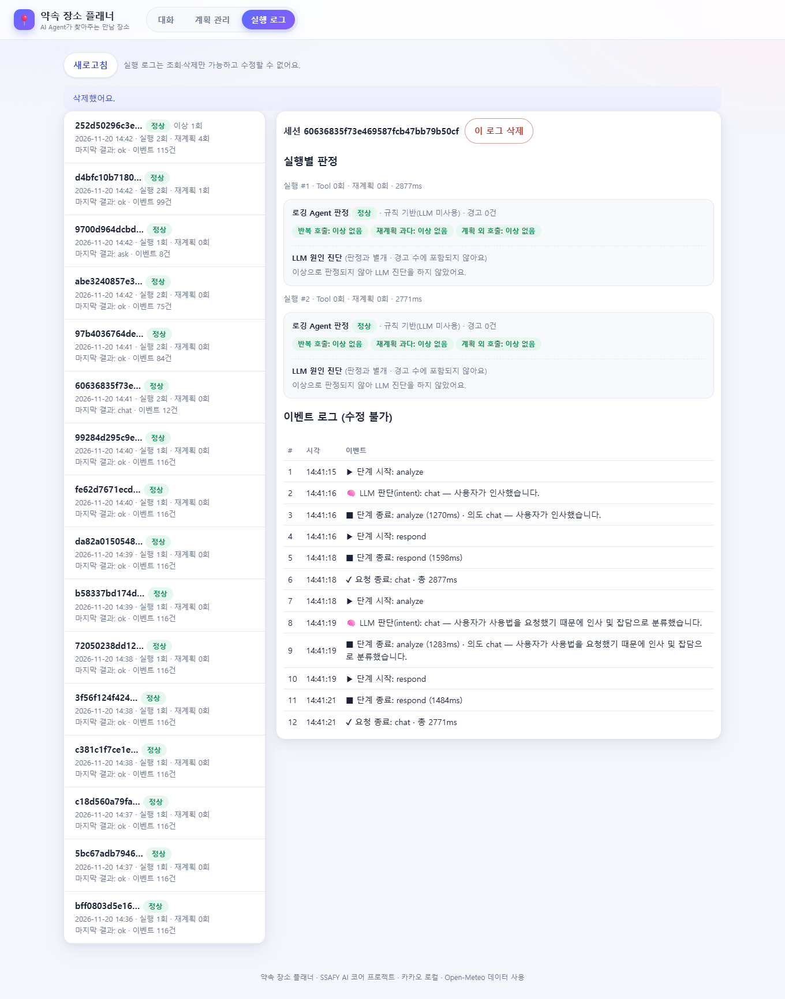

## 4.4 계획 관리 확인 (F3015~F3016)

- 대화 화면의 추천 카드에서 "이 역으로 계획 저장" → 계획이 저장되고, **같은 날짜에 시간이 겹치는 계획이 있으면 저장은 되고 겹치는 계획(#1 14:00 건대입구역)이 저장 결과와 함께 알려진다.**

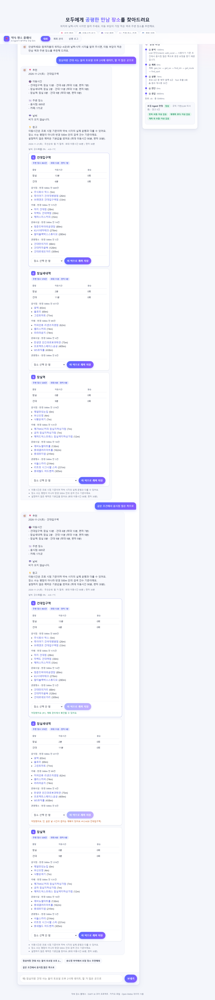

- 계획 관리 화면에서 핵심 값(날짜·시작·종료·역·장소)과 생성 일시가 목록에 표시되고, 수정·삭제 결과가 목록에 바로 반영된다.

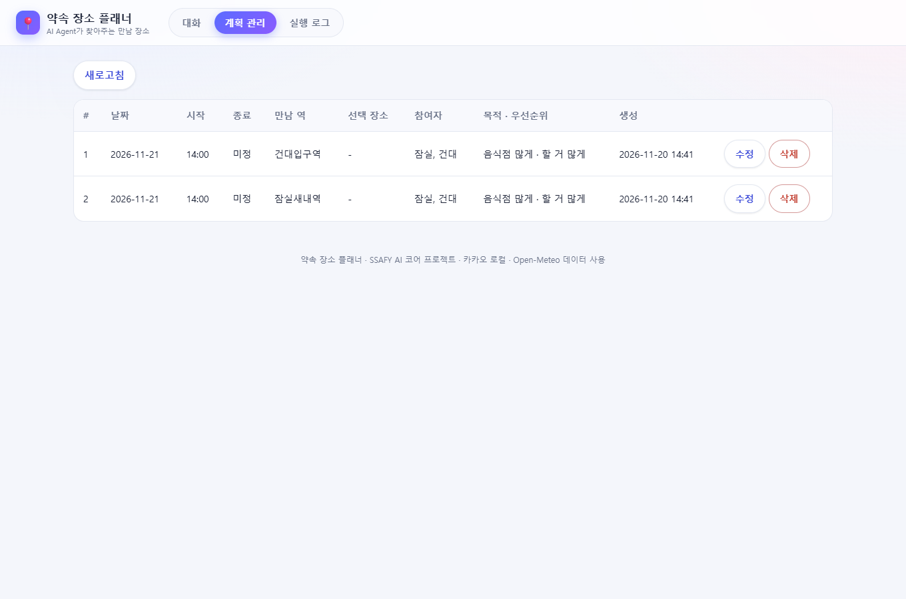

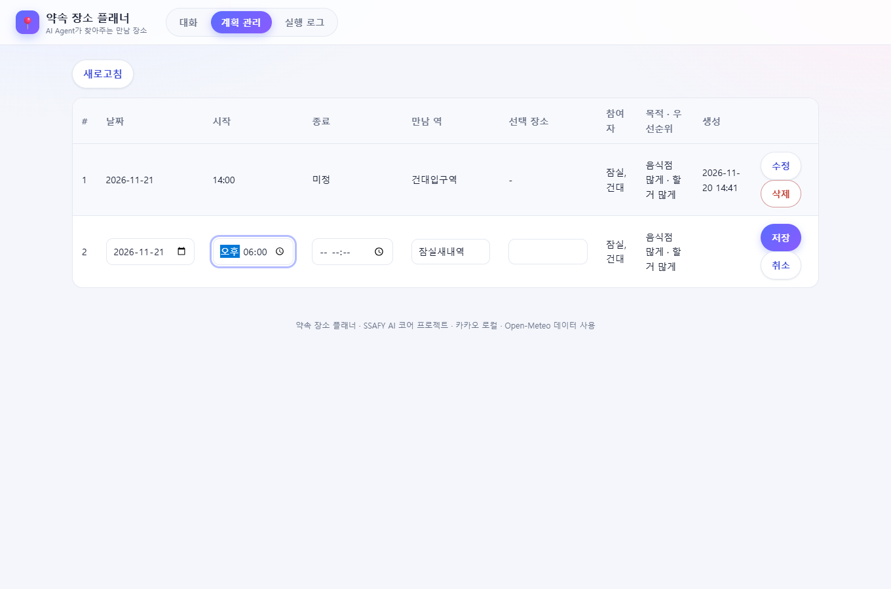

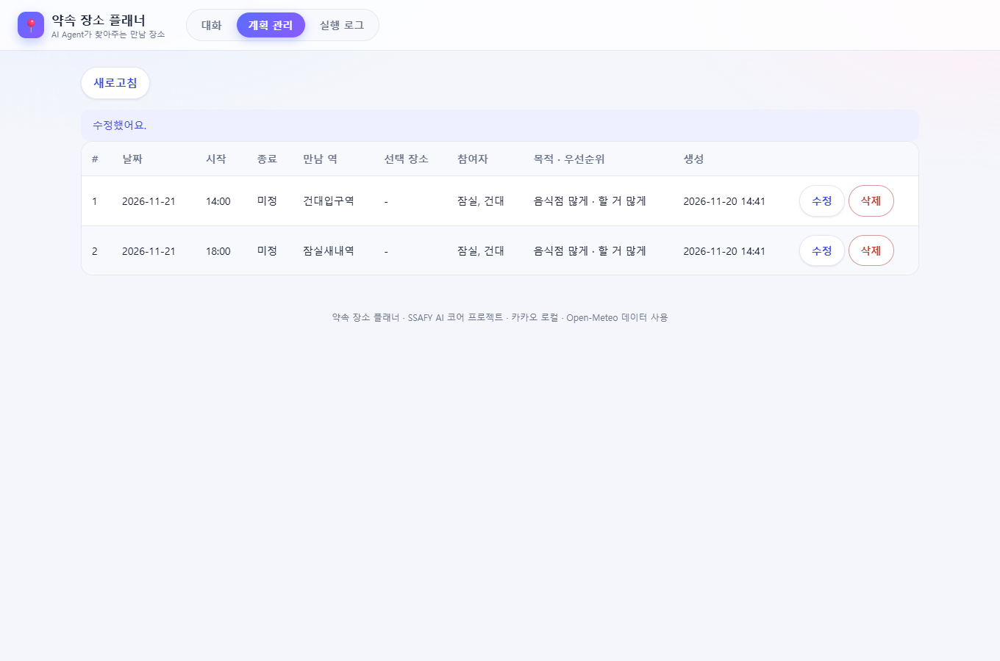

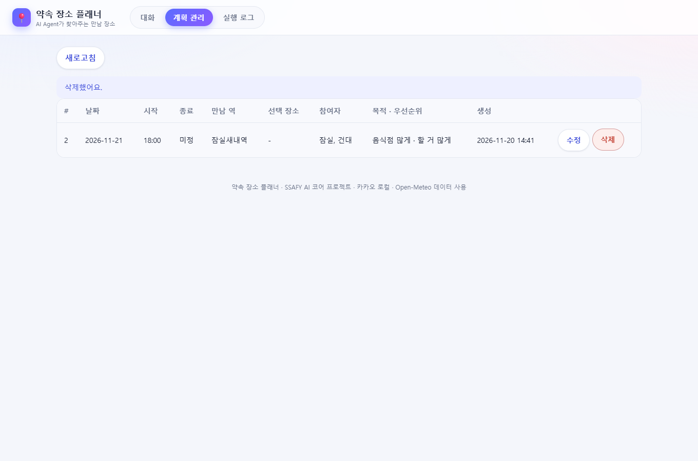

## 4.5 서비스 구성과 화면 확인 (F3017~F3019)

- **API 경로·형식**: 대화(`/api/chat`)·계획(`/api/plans`)·로그(`/api/logs`)가 서로 다른 경로로 동작하고 요청·응답이 Pydantic 모델과 일치한다 (FastAPI 문서 화면 20, [openapi.json](openapi.json), [04_API명세서.md](04_API명세서.md)).

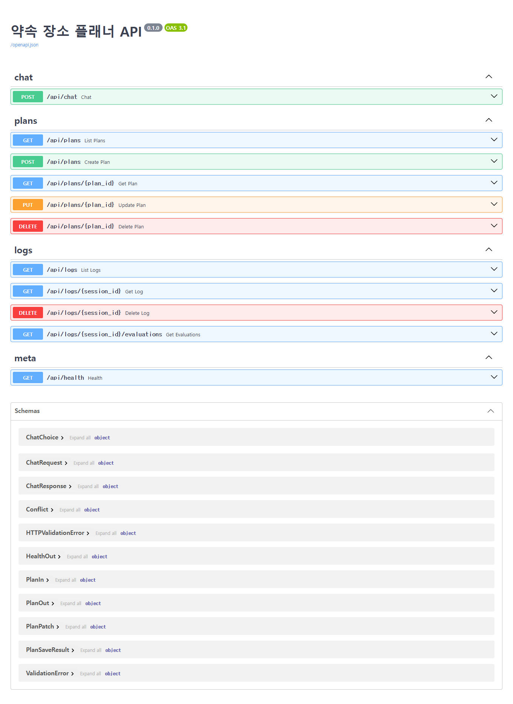

- 대화·계획 관리·실행 로그 화면이 모두 백엔드 API 를 호출해 데이터를 표시한다.
- **처리 중 상태**, 실행 단계·Tool 호출 이력(순서대로), 재계획 지점 구분:

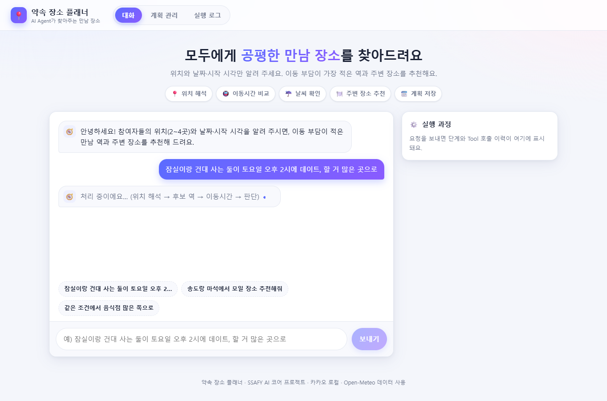

- **Tool 실패**: S4 (화면 07). **API 키 누락**: 설정 배너와 오류 안내 (S9):

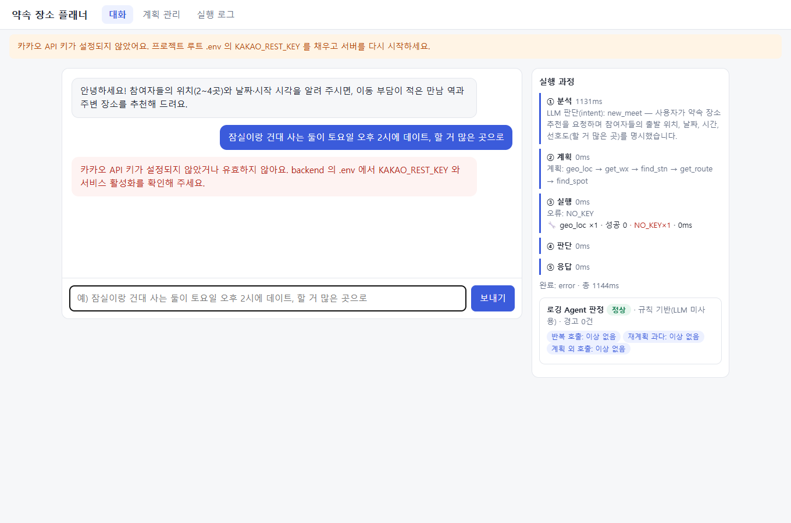

## 4.6 심화 기능 확인: F3020 (로깅 Agent 평가)

명세서는 이상 실행을 **각각 만들어** 식별되는지 확인하라고 한다. 반복 호출·계획 외 호출·근거 없음은 운영 중 저절로 생기지 않으므로, Tool 실패에 `FAIL_INJECT` 를 쓴 것처럼 **검증용 주입 환경변수 `ANOMALY_INJECT`** 로 실제 서버에서 만들었다(운영에서는 비워 둠). 아래는 모두 **실제 서버·실제 LLM 으로 실행**한 결과이고, 같은 케이스를 단위 테스트로도 확인했다 (`tests/test_evaluation.py`).

| 확인 항목 | 만든 방법 | 실제 실행 결과 | 증빙 |
|---|---|---|---|
| 같은 Tool 을 같은 입력으로 반복 호출한 실행이 이상으로 식별 | `ANOMALY_INJECT=repeat_call` (`get_wx` 를 같은 입력으로 한 번 더 호출) | **`anomaly`** · get_wx 가 같은 입력으로 2회 호출됨 · 규칙별 `{'repeated_call': 'warn', 'excess_replan': 'ok', 'unplanned_call': 'ok'}` | [로그](samples/A1_repeat_call_run_log.md), [판정](samples/A1_repeat_call_evaluations.json), 화면 21 |
| 재계획을 과도하게 반복한 실행 식별 | 실제 요청 "수원+춘천" (재계획 상한 도달, 주입 없음) | **`anomaly`** · 재계획 3회 (상한 3회 도달) | [로그](samples/S3_limit_run_log.md), [판정](samples/S3_evaluations.json), 화면 17 |
| 계획에 없던 Tool 호출 식별 | `ANOMALY_INJECT=unplanned_call` (계획에서 `get_wx` 를 빼고 실행은 그대로 호출) | **`anomaly`** · 계획에 없던 Tool: get_wx×1 (계획: ['geo_loc', 'find_stn', 'get_route', 'find_spot']) | [로그](samples/A2_unplanned_call_run_log.md), [판정](samples/A2_unplanned_call_evaluations.json), 화면 22 |
| 근거 이벤트가 없을 때 '이상 없음'이 아니라 '판정 불가' | `ANOMALY_INJECT=missing_events` (실행 시작 이벤트가 유실된 상황) | **`unknown`(판정 불가)** · 규칙별 `{'repeated_call': 'na', 'excess_replan': 'na', 'unplanned_call': 'na'}`, 경고 0건, 로그에 `analyze` 시작 이벤트 없음 | [로그](samples/A3_missing_events_run_log.md), [판정](samples/A3_missing_events_evaluations.json), 화면 23 |
| 판단 결과를 메인 Agent 가 참조 | S3 세션의 2번째 실행 (직전 실행이 `anomaly`) | 분석 단계 종료 이벤트 #71 에 직전 판정이 기록됨: `prev_eval=anomaly`, `prev_warnings=['excess_replan']` | [S3 세션 로그](samples/S3_limit_run_log.md) 이벤트 `#71` |
| 정상 실행에는 LLM 진단을 호출하지 않음 | 정상 실행 S1 | 판정 `ok`, 진단 `skipped` (LLM 미호출). `unknown`(A3)도 진단 `skipped` | [S1 판정](samples/S1_evaluations.json), 화면 18 |
| 이상 실행에만 원인 진단이 붙고, 판정과 구분되어 저장 | A1·A2·S3 | 진단 `done`(세 문장 이내), `warning_count` 는 진단과 무관(각각 1·1·1건) | 화면 17·21·22 |
| 진단이 실패해도 판정·로그 유지 | 진단 LLM 이 예외를 내는 상황 | 판정은 그대로 저장되고 `diagnosis.status=failed` | 단위 테스트 `test_diagnosis_failure_keeps_judgment` |

**실제 LLM 진단 예**

- 반복 호출(A1): `get_wx` 툴이 동일한 입력으로 두 번 호출된 것은 메인 Agent의 계획 또는 실행 단계에서 불필요한 중복 작업이 발생했기 때문입니다. 이 중복 호출을 제거하도록 계획 로직을 수정해야 합니다.
- 재계획 과다(S3 수원+춘천): 문제는 메인 Agent의 판단 과정에서 발생했습니다. 사용자가 요청한 약속에 대한 후보가 전혀 충족되지 않아 재계획이 상한에 도달했습니다. 사용자의 이동시간 및 편차 제약을 재검토하여 현실적으로 충족 가능한 조건으로 수정해야 합니다.

관찰: A2(계획 외 호출)의 진단은 "Agent 나 Tool 에 문제가 없어 보인다"는 취지로 끝난다. 주입으로 만든 이상이라 모델이 알 수 있는 단서(실행 기록 요약)에 한계가 있기 때문이며, 판정(규칙)은 정확하지만 **LLM 진단의 정확도는 보장되지 않는다**는 점을 한계로 기록한다.

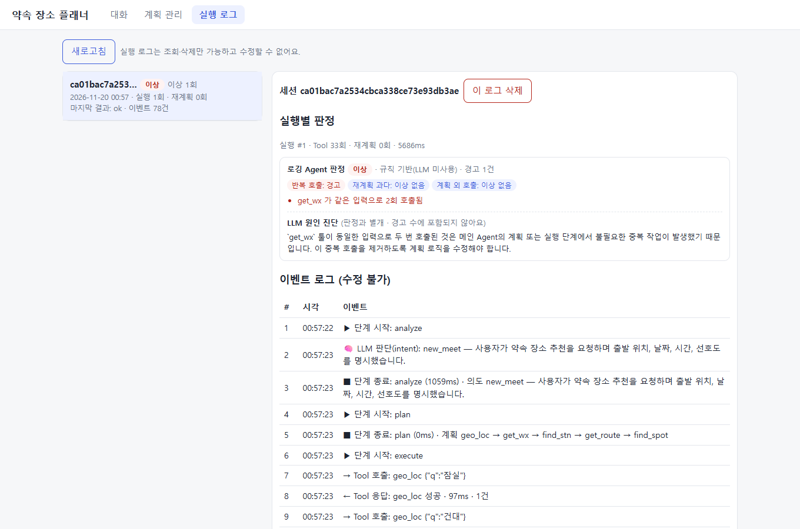

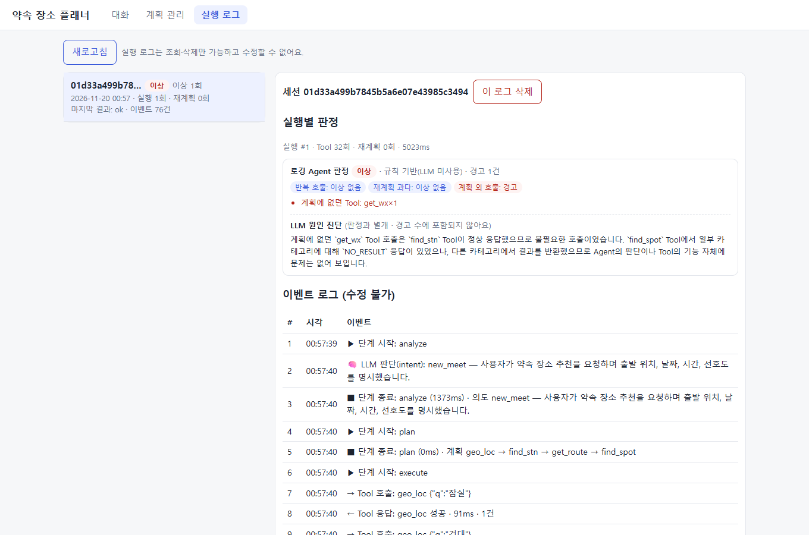

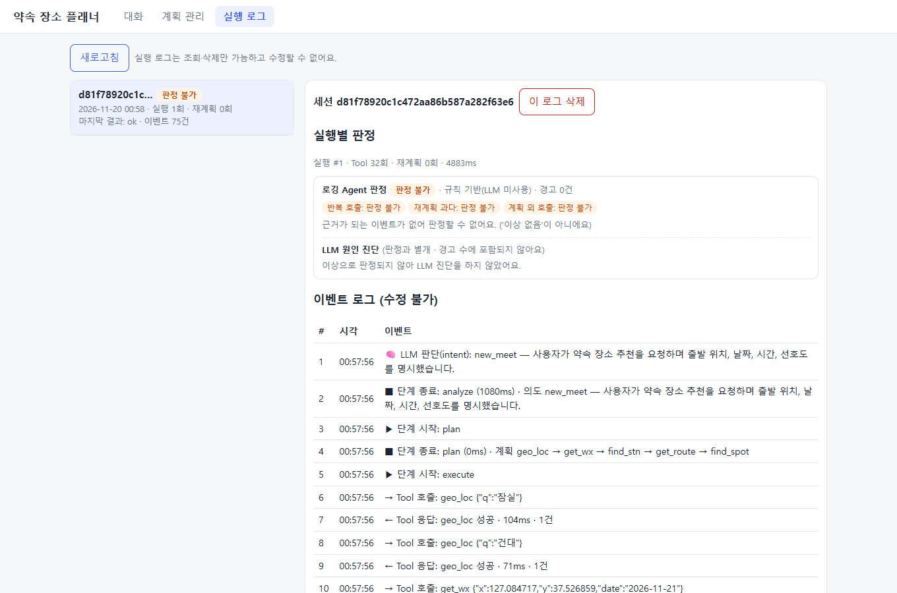

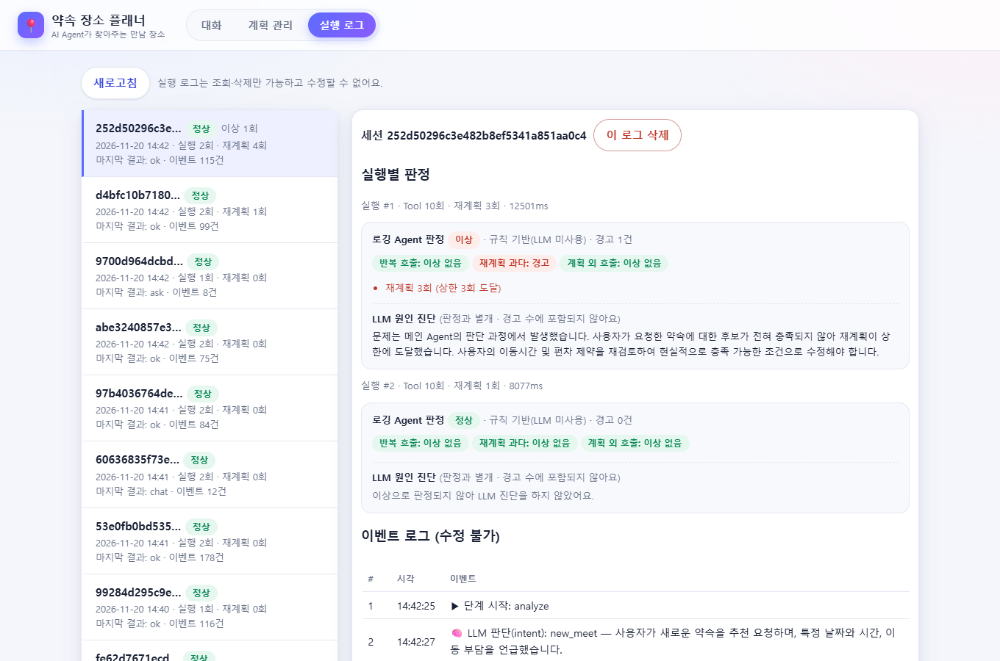

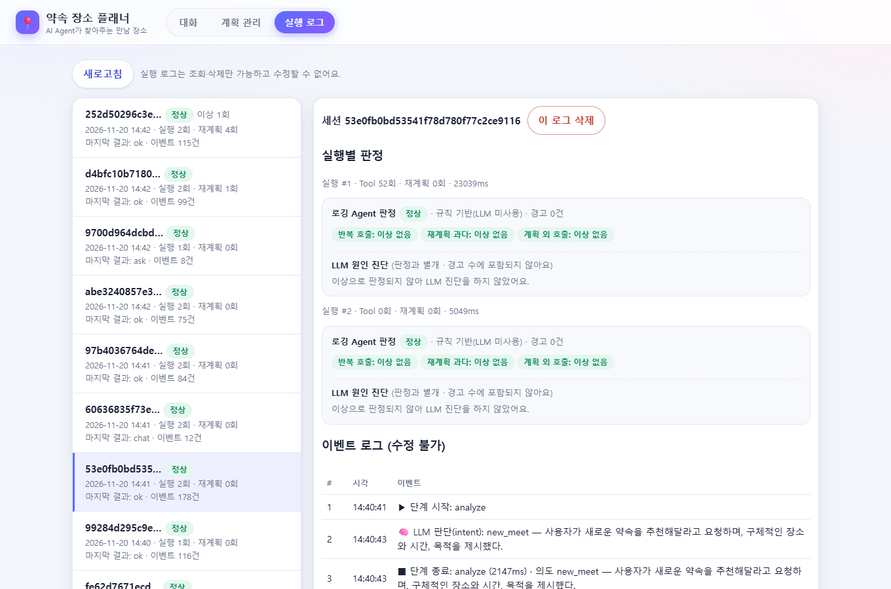

**한계**: 재계획 과다를 "상한 도달"로 정의해, 사용자 조건이 현실적으로 충족 불가능한 요청도 `anomaly` 로 판정된다. 진단 프롬프트가 이 경우를 사용자 조건 문제로 구분하도록 했다 (S3 진단 참조).

## 4.7 대표 시나리오 검증

대표 요청 11개를 실행했다. 아래를 모두 포함한다: 제약을 한 번에 충족(S1) · 재계획이 필요(S2) · 상한에 도달(S3) · Tool 하나가 실패(S4) · Tool 이 필요 없음(S5). 그 밖에 후속 요청(S6), 조건 부족 되묻기(S7·S8·S10), API 키 누락(S9), 로깅 Agent 미연결(S11). 요청마다 **실행 결과(최종 응답) · 실행 로그(단계·Tool 호출 이력·재계획 여부) · 기대와 실제의 차이**를 기록했다.

| 시나리오 | 요청 | 결과 | 재계획 | 소요(시나리오 전체 요청 합계) |
|---|---|---|---|---|
| S1 한 번에 충족 | 잠실이랑 건대 사는 둘이 토요일 오후 2시에 데이트, 할 거 많은 곳으로 | `answer/ok` | 0회 | 23.4초 |
| S2 재계획 후 충족 | 중앙이랑 건대 사는 둘이 토요일 오후 2시에 만날래, 이동 적게 | `answer/ok` | 1회 | 18.9초 |
| S3 상한 도달 | 수원이랑 춘천 사는 둘이 토요일 오후 2시에 만나고 싶어, 이동 적게 | `answer/ok` | 4회 | 21.1초 |
| S4 Tool 하나 실패 | 잠실이랑 건대 사는 둘이 토요일 오후 2시에 만날래, 이동 부담 적게 | `answer/ok` | 0회 | 6.3초 |
| S5 Tool 불필요 | 안녕 | `answer/chat` | 0회 | 6.1초 |
| S6 후속 요청 | 같은 조건에서 음식점 많은 쪽으로 | `answer/ok` | 0회 | 5.3초 |
| S7 조건 부족 | 송도랑 마석에서 모일 장소 추천해줘 | `answer/ok` | 0회 | 21.3초 |
| S8 우선순위 되묻기 | 잠실이랑 건대 사는 둘이 토요일 오후 2시에 데이트 | `answer/ok` | 0회 | 15.0초 |
| S9 API 키 누락 | 잠실이랑 건대 사는 둘이 토요일 오후 2시에 데이트, 할 거 많은 곳으로 | `error/error` | 0회 | 1.2초 |
| S10 임의 채움 방지 | 잠실에서 7시 전에 끝나야 해 | `ask/ask` | 0회 | 1.7초 |
| S11 로깅 Agent 미연결 | 잠실이랑 건대 사는 둘이 토요일 오후 2시에 데이트, 할 거 많은 곳으로 | `answer/ok` | 0회 | 5.0초 |

재계획·소요는 시나리오의 모든 요청 합계다(S2·S3·S7·S8 은 되묻기·버튼 요청 포함, S3 는 상한 도달 3회 + 완화 후 재실행 1회). S1~S3·S5~S8·S10 은 2026-11-20 배포 서버(Render 무료)·GPT 실행 기록이고, S4·S9·S11 과 F3020 주입(A1~A3)은 환경변수 주입이 필요해 같은 날 로컬(LLM=Gemini)에서 실행한 기록이다.

#### S1. 제약을 한 번에 충족

**기대한 동작**: 재계획 없이 충족하는 후보 3곳을 판단 근거와 함께 추천, 실행 과정 표시.

**요청 1**: `잠실이랑 건대 사는 둘이 토요일 오후 2시에 데이트, 할 거 많은 곳으로` → 결과 `answer/ok` · 23.4초

- 실행 단계: analyze → plan → execute → judge → respond
- Tool 호출: geo_loc ×2, get_wx ×1, find_stn ×1, get_route ×16, find_spot ×32 (실패/결과없음: find_spot:NO_RESULT×5) · 재계획 0회
- LLM 판단: `new_meet` — 사용자가 새로운 약속을 추천해달라고 요청하며, 구체적인 장소와 시간, 목적을 제시했다.
- 로깅 Agent 판정: `ok` 
- 최종 응답: '📍 추천   2026-11-21(토) · 건대입구역  🚇 이동시간   - 건대입구역: 잠실 13분 · 건대 6분 (최대 13분, 편차 7분)   - 잠실새내역: 잠실 2분 · 건대 11분 (최대 11분, 편차 9분)   - 잠실역: 잠실 0분 · 건대 9분 (최대 9분, 편차 9분)    🍽️ 주변 장소   - 음식점: 669곳   - 카페: 175곳    ☔ 날씨   비가 오지 않습니다.    💡 참고   이동시간은 조회 시점 기준이며 약속 시각의 실제 운행과 다를 수 있어요.   장소 수는 평점이 아니라 반경 500m 안의 검색 건수 기준이에요.   설정하지 않은 제약은 기본값을 썼어요 (최대 이동시간 90분, 편차 30분).'

| 순위 | 역 | 이동시간(환승) | 최대/편차 | 점수 | 주변 장소 수 |
|---|---|---|---|---|---|
| 1 | 건대입구역 | 잠실 13분(0), 건대 6분(0) | 13/7분 | 863 | 음식점 669, 카페 175, 문화시설 14, 관광명소 5 |
| 2 | 잠실새내역 | 잠실 2분(0), 건대 11분(0) | 11/9분 | 570 | 음식점 477, 카페 89, 문화시설 4, 관광명소 0 |
| 3 | 잠실역 | 잠실 0분(0), 건대 9분(0) | 9/9분 | 528 | 음식점 374, 카페 131, 문화시설 18, 관광명소 5 |

**기대와 실제의 차이**: **없음.** 기대대로 동작했다.

#### S2. 재계획 후 충족 (위치 모호 → 선택 → 재계획)

**기대한 동작**: 위치가 모호하면 후보 버튼으로 되묻고(재계획 아님), 선택 후 반경 3000m 에서 충족 후보가 없으면 5000m 로 재계획해 충족하는 후보를 추천.

**요청 1**: `중앙이랑 건대 사는 둘이 토요일 오후 2시에 만날래, 이동 적게` → 결과 `ask/ask` · 2.4초

- 실행 단계: analyze → plan → execute → judge → respond
- Tool 호출: geo_loc ×1 (실패/결과없음: geo_loc:AMBIGUOUS×1) · 재계획 0회
- LLM 판단: `new_meet` — 사용자가 새로운 약속을 추천 요청하며, 날짜와 시간, 이동 부담을 언급했습니다.
- 되묻기: `disambiguate` ['중앙역 (경기 안산시 단원구 중앙대로 918)', '중앙역 (부산 중구 중앙대로 지하 83)']
- 로깅 Agent 판정: `ok` 
- 최종 응답: "'중앙' 위치가 여러 곳이에요. 어느 곳인가요?"

**요청 2**: `(버튼) 중앙역 (경기 안산시 단원구 중앙대로 918)` → 결과 `answer/ok` · 16.5초

- 실행 단계: analyze → plan → execute → judge → replan → plan → execute → judge → respond
- Tool 호출: geo_loc ×1, get_wx ×1, find_stn ×2, get_route ×16, find_spot ×12 (실패/결과없음: find_stn:NO_RESULT×1, find_spot:NO_RESULT×2) · 캐시 재사용 1건 · 재계획 1회 (반경 3000m→5000m, 후보 수 8→8)
- 로깅 Agent 판정: `ok` 
- 최종 응답: '📍 추천   2026-11-21(토) 대공원역    🚇 이동시간   - 대공원역: 중앙 33분 · 건대 40분 (최대 40분, 편차 7분)   - 과천역: 중앙 31분 · 건대 42분 (최대 42분, 편차 11분)   - 정부과천청사역: 중앙 29분 · 건대 44분 (최대 44분, 편차 15분)    🍽️ 주변 장소   - 대공원역: 음식점 10개, 카페 1개, 문화시설 12개, 관광명소 3개   - 과천역: 음식점 20개, 카페 9개    ☔ 날씨   비가 내리지 않습니다.    💡 참고   - 안양역: 이동시간 편차 36분이 상한 30분 초과   - 범계역: 이동시간 편차 31분이 상한 30분 초과   - 이동시간은 조회 시점 기준이며 약속 시각의 실제 운행과 다를 수 있어요.'

| 순위 | 역 | 이동시간(환승) | 최대/편차 | 점수 | 주변 장소 수 |
|---|---|---|---|---|---|
| 1 | 대공원역 | 중앙 33분(0), 건대 40분(1) | 40/7분 | -73 | 음식점 10, 카페 1, 문화시설 12, 관광명소 3 |
| 2 | 과천역 | 중앙 31분(0), 건대 42분(1) | 42/11분 | -73 | 음식점 20, 카페 9, 문화시설 0, 관광명소 0 |
| 3 | 정부과천청사역 | 중앙 29분(0), 건대 44분(1) | 44/15분 | -73 | 음식점 215, 카페 56, 문화시설 5, 관광명소 1 |

제외 사유: 안양역: 이동시간 편차 36분이 상한 30분 초과; 범계역: 이동시간 편차 31분이 상한 30분 초과

**기대와 실제의 차이**: **있음(설계서 예시와 다름).** 설계서는 "송도+마석"이 반경 3km 에서 편차 상한을 넘어 재계획된다고 예상했으나, 실제로는 재계획 없이 충족했다(S7 의 용산역). 원인: 설계서 예시는 호출 전의 추정이었고 실제 대중교통 시간은 달랐다. 수정: 후보 지역 쌍 13개를 실제 호출로 탐색해 재계획 1회로 충족하는 "중앙(안산)+건대" 를 대표 시나리오로 교체했다 (이 쌍에서는 3000m 안에 역이 없어 재계획).

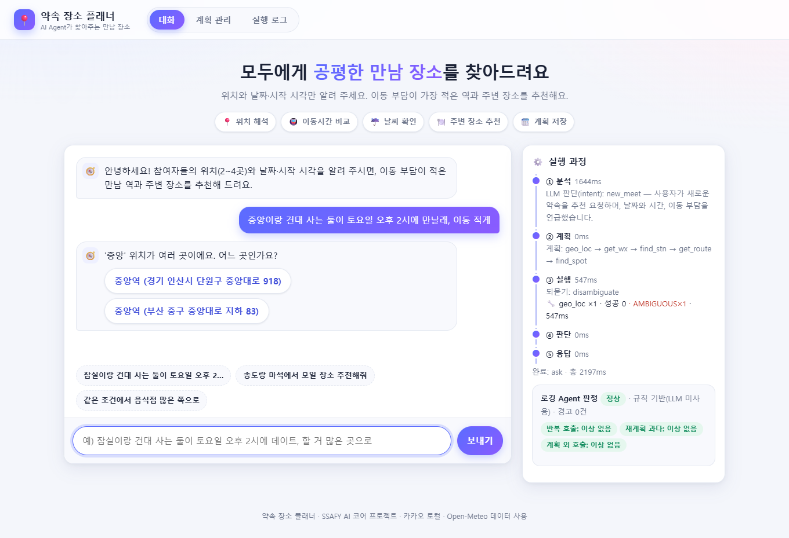

#### S3. 재계획 상한 도달 → 조건 완화

**기대한 동작**: 재계획 3회에서 멈추고 사유와 함께 조건 조정을 되묻는다. 완화 버튼을 누르면 그 값으로 다시 탐색한다.

**요청 1**: `수원이랑 춘천 사는 둘이 토요일 오후 2시에 만나고 싶어, 이동 적게` → 결과 `ask/limit` · 12.7초

- 실행 단계: analyze → plan → execute → judge → replan → plan → execute → judge → replan → plan → execute → judge → replan → plan → execute → judge → respond
- Tool 호출: geo_loc ×2, get_wx ×1, find_stn ×3, get_route ×4 (실패/결과없음: find_stn:NO_RESULT×1) · 캐시 재사용 10건 · 재계획 3회 (반경 3000m→5000m, 후보 수 8→8; 반경 5000m→8000m, 후보 수 8→8; 반경 8000m→8000m, 후보 수 8→12)
- LLM 판단: `new_meet` — 사용자가 새로운 약속을 추천 요청하며, 특정 날짜와 시간, 이동 부담을 언급했습니다.
- 되묻기: `relax` ['최대 이동시간 120분으로 완화', '편차 상한 45분으로 완화']
- 로깅 Agent 판정: `anomaly` ['재계획 3회 (상한 3회 도달)']
- 최종 응답: '⚠️ 조건 충족 후보 없음   - 양수역: 춘천의 이동시간 94분이 상한 90분 초과   - 운길산역: 춘천의 이동시간 91분이 상한 90분 초과   - 신원역: 춘천의 이동시간 99분이 상한 90분 초과   - 국수역: 춘천의 이동시간 103분이 상한 90분 초과   - 조건 조정 제안: 최대 이동시간을 늘려보세요.    📍 추천: 2026-11-21(토)    💡 참고: 이동시간은 조회 시점 기준이며 약속 시각의 실제 운행과 다를 수 있어요.   💡 참고: 설정하지 않은 제약은 기본값을 썼어요 (최대 이동시간 90분, 편차 30분).   💡 참고: 충족 후보가 없어 검색 범위를 넓혀 3회 재계획했어요.'

제외 사유: 양수역: 춘천의 이동시간 94분이 상한 90분 초과; 운길산역: 춘천의 이동시간 91분이 상한 90분 초과; 신원역: 춘천의 이동시간 99분이 상한 90분 초과; 국수역: 춘천의 이동시간 103분이 상한 90분 초과

가장 근접했던 후보: 운길산역 (최소 91분 이상, 초과 1분)

**요청 2**: `(버튼) 최대 이동시간 120분으로 완화` → 결과 `answer/ok` · 8.4초

- 실행 단계: analyze → plan → execute → judge → replan → plan → execute → judge → respond
- Tool 호출: get_route ×2, find_spot ×8 (실패/결과없음: find_spot:NO_RESULT×3) · 캐시 재사용 6건 · 재계획 1회 (반경 3000m→5000m, 후보 수 8→8)
- 로깅 Agent 판정: `ok` 
- 최종 응답: '📍 추천   - 2026-11-21(토) · 운길산역  🚇 이동시간   - 운길산역: 수원 96분 · 춘천 91분 (최대 96분, 편차 5분)   - 양수역: 수원 99분 · 춘천 94분 (최대 99분, 편차 5분)    🍽️ 주변 장소   - 운길산역: 음식점 9개, 카페 3개   - 양수역: 음식점 27개, 카페 7개    ☔ 날씨   - 비가 오지 않습니다.    💡 참고   - 이동시간은 조회 시점 기준이며 약속 시각의 실제 운행과 다를 수 있어요.   - 설정하지 않은 제약은 기본값을 썼어요 (최대 이동시간 120분, 편차 30분).   - 충족 후보가 없어 검색 범위를 넓혀 1회 재계획했어요.'

| 순위 | 역 | 이동시간(환승) | 최대/편차 | 점수 | 주변 장소 수 |
|---|---|---|---|---|---|
| 1 | 운길산역 | 수원 96분(3), 춘천 91분(1) | 96/5분 | -187 | 음식점 9, 카페 3, 문화시설 0, 관광명소 2 |
| 2 | 양수역 | 수원 99분(3), 춘천 94분(2) | 99/5분 | -193 | 음식점 27, 카페 7, 문화시설 0, 관광명소 0 |

**기대와 실제의 차이**: **있음(개발 중 발견·수정 완료).** 최초 설계서의 "서울+부산"으로 실행했을 때 상한은 도달했지만 안내가 "이동시간 상한을 늘릴까요?" 였다. 원인: 두 지역의 중간 지점 반경 8km 안에 지하철역이 없어 후보 자체가 없는 경우였기 때문에 제약 완화로는 해결되지 않는다. 수정: 이 경우 "서로 더 가까운 위치로 알려 달라"(`relax_region`)로 분기하고, 제약 때문에 도달한 경우(수원+춘천)에만 완화 버튼을 보인다 (`test_limit_without_any_station_asks_for_closer_locations_not_looser_constraints`). 위 기록은 수정 후 대표 요청 "수원+춘천" 결과다.

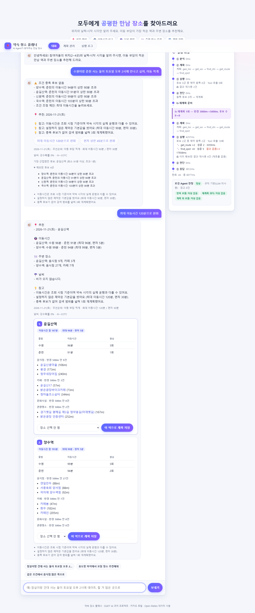

#### S4. Tool 하나가 실패 (get_route 3번에 1번 NO_ROUTE 주입)

**기대한 동작**: 실패한 후보만 제외하고 사유를 표기하며 나머지로 추천을 계속한다. 서비스는 중단되지 않는다.

**요청 1**: `잠실이랑 건대 사는 둘이 토요일 오후 2시에 만날래, 이동 부담 적게` → 결과 `answer/ok` · 6.3초

- 실행 단계: analyze → plan → execute → judge → respond
- Tool 호출: geo_loc ×2, get_wx ×1, find_stn ×1, get_route ×12, find_spot ×12 (실패/결과없음: get_route:NO_ROUTE×4, find_spot:NO_RESULT×3) · 재계획 0회
- LLM 판단: `new_meet` — 사용자가 약속 장소 추천을 요청하며 출발 위치, 날짜, 시간, 선호도를 명시했습니다.
- 로깅 Agent 판정: `ok` 
- 최종 응답: '2026년 11월 21일 토요일 약속 장소로 강변역이 가장 적합합니다. 강변역은 잠실까지 5분, 건대까지 4분이 소요되어 이동 부담이 적으며, 이동 시간 편차도 1분으로 매우 짧습니다. 구의역은 잠실까지 6분, 건대까지 3분이 걸리지만 이동 시간 편차가 3분으로 강변역보다 큽니다. 잠실나루역은 잠실까지 2분, 건대까지 7분이 걸리지만 이동 시간 편차가 5분으로 가장 큽니다. 건대입구역, 자양역, 잠실새내역, 종합운동장역은 경로를 찾지 못해 제외되었습니다. 날씨는 맑을 것으로 예상됩니다.'

| 순위 | 역 | 이동시간(환승) | 최대/편차 | 점수 | 주변 장소 수 |
|---|---|---|---|---|---|
| 1 | 강변역 | 잠실 5분(0), 건대 4분(0) | 5/1분 | -9 | 음식점 122, 카페 36, 문화시설 2, 관광명소 0 |
| 2 | 구의역 | 잠실 6분(0), 건대 3분(0) | 6/3분 | -9 | 음식점 392, 카페 62, 문화시설 4, 관광명소 1 |
| 3 | 잠실나루역 | 잠실 2분(0), 건대 7분(0) | 7/5분 | -9 | 음식점 152, 카페 40, 문화시설 0, 관광명소 0 |

제외 사유: 건대입구역: 경로를 찾지 못해 판단하지 않음 (NO_ROUTE); 자양역: 경로를 찾지 못해 판단하지 않음 (NO_ROUTE); 잠실새내역: 경로를 찾지 못해 판단하지 않음 (NO_ROUTE); 종합운동장역: 경로를 찾지 못해 판단하지 않음 (NO_ROUTE)

**기대와 실제의 차이**: **없음.** 실패한 4곳은 값 없이 "판단하지 않음"으로 제외됐다. (자연 발생 `NO_ROUTE` 는 서울→부산 호출로 별도 확인: tool_checks.md.)

#### S5. Tool 이 필요 없는 요청

**기대한 동작**: 계획 단계를 건너뛰고 Tool 호출 없이 바로 응답한다.

**요청 1**: `안녕` → 결과 `answer/chat` · 3.1초

- 실행 단계: analyze → respond
- Tool 호출: 없음 · 재계획 0회
- LLM 판단: `chat` — 사용자가 인사했습니다.
- 로깅 Agent 판정: `ok` 
- 최종 응답: '안녕하세요! 약속 장소를 계획하는 데 도움이 필요하신가요? 위치와 날짜, 시간을 알려주시면 추천해드릴게요!'

**요청 2**: `사용법 알려줘` → 결과 `answer/chat` · 3.0초

- 실행 단계: analyze → respond
- Tool 호출: 없음 · 재계획 0회
- LLM 판단: `chat` — 사용자가 사용법을 요청했기 때문에 인사 및 잡담으로 분류했습니다.
- 로깅 Agent 판정: `ok` 
- 최종 응답: '약속 장소 플래너를 사용하려면, 참여자 수(2~4명)와 각자의 위치, 만남 날짜 및 시작 시각을 알려주세요. 그러면 이동 부담이 적은 만남 역과 주변 장소를 추천해 드릴게요!'

**기대와 실제의 차이**: **없음.** 실행 단계가 분석→응답뿐이고 Tool 호출 0회.

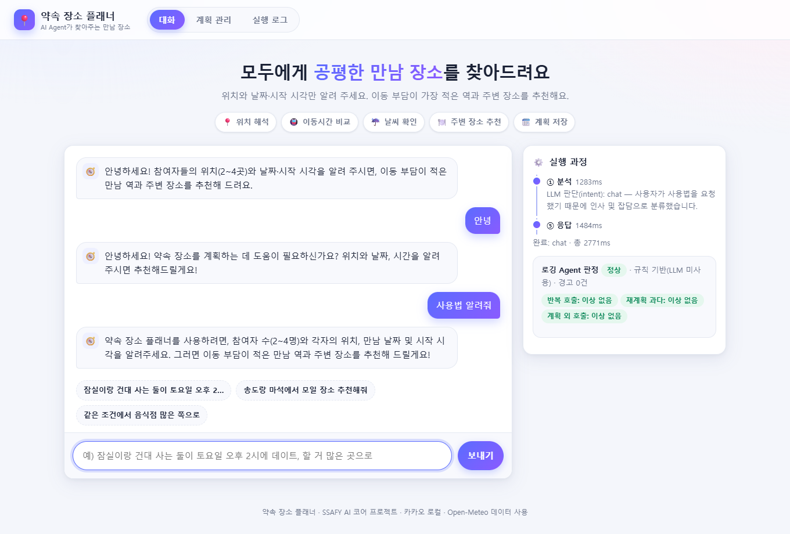

#### S6. 후속 요청 (Memory)

**기대한 동작**: 위치·날짜·시각은 유지하고 우선순위만 갱신, 이미 조회한 이동시간은 다시 부르지 않는다.

**요청 1**: `같은 조건에서 음식점 많은 쪽으로` → 결과 `answer/ok` · 5.3초

- 실행 단계: analyze → plan → execute → judge → respond
- Tool 호출: 없음 · 캐시 재사용 50건 · 재계획 0회
- LLM 판단: `edit_cond` — 사용자가 기존 조건에서 음식점 많은 쪽으로 변경 요청을 했기 때문입니다.
- 로깅 Agent 판정: `ok` 
- 최종 응답: '📍 추천   2026-11-21(토) · 건대입구역  🚇 이동시간   - 건대입구역: 잠실 13분 · 건대 6분 (최대 13분, 편차 7분)   - 잠실새내역: 잠실 2분 · 건대 11분 (최대 11분, 편차 9분)   - 잠실역: 잠실 0분 · 건대 9분 (최대 9분, 편차 9분)    🍽️ 주변 장소   - 음식점: 669곳   - 카페: 175곳    ☔ 날씨   비가 오지 않습니다.    💡 참고   이동시간은 조회 시점 기준이며 약속 시각의 실제 운행과 다를 수 있어요.   장소 수는 평점이 아니라 반경 500m 안의 검색 건수 기준이에요.   설정하지 않은 제약은 기본값을 썼어요 (최대 이동시간 90분, 편차 30분).'

| 순위 | 역 | 이동시간(환승) | 최대/편차 | 점수 | 주변 장소 수 |
|---|---|---|---|---|---|
| 1 | 건대입구역 | 잠실 13분(0), 건대 6분(0) | 13/7분 | 863 | 음식점 669, 카페 175, 문화시설 14, 관광명소 5 |
| 2 | 잠실새내역 | 잠실 2분(0), 건대 11분(0) | 11/9분 | 570 | 음식점 477, 카페 89, 문화시설 4, 관광명소 0 |
| 3 | 잠실역 | 잠실 0분(0), 건대 9분(0) | 9/9분 | 528 | 음식점 374, 카페 131, 문화시설 18, 관광명소 5 |

**기대와 실제의 차이**: **있음(GPT 실행에서 발견, 프롬프트 수정 완료).** 첫 실행에서 우선순위가 갱신되지 않았다(위 4.2 F3010 설명). 수정 후 8회 반복에서 모두 `음식점 많게` 로 반영됨을 확인했으나, 카카오맵 대중교통 API 의 일시 오류로 수정 후 최종 화면은 재촬영하지 못했다.

#### S7. 조건 부족 → 되묻기 → 답변

**기대한 동작**: 날짜·시작 시각이 없으면 Tool 호출 전에 되묻고, 답변을 받으면 이어서 처리한다.

**요청 1**: `송도랑 마석에서 모일 장소 추천해줘` → 결과 `ask/ask` · 2.0초

- 실행 단계: analyze → plan → respond
- Tool 호출: 없음 · 재계획 0회
- LLM 판단: `new_meet` — 사용자가 송도와 마석에서 모일 장소 추천을 요청했기 때문에 새 약속 추천 요청으로 분류했습니다.
- 되묻기: `missing` 
- 로깅 Agent 판정: `ok` 
- 최종 응답: '날짜, 시작 시각을(를) 알려 주세요. 예) "잠실이랑 건대, 토요일 오후 2시"'

**요청 2**: `토요일 3시, 이동 부담 적게` → 결과 `answer/ok` · 19.3초

- 실행 단계: analyze → plan → execute → judge → respond
- Tool 호출: geo_loc ×2, get_wx ×1, find_stn ×1, get_route ×16, find_spot ×12 (실패/결과없음: find_spot:NO_RESULT×1) · 재계획 0회
- LLM 판단: `edit_cond` — 사용자가 약속의 날짜와 시간을 수정하고 이동 부담을 추가로 언급했기 때문에.
- 로깅 Agent 판정: `ok` 
- 최종 응답: '📍 추천   - 2026-11-21(토)   - 용산역    🚇 이동시간   - 용산역: 송도 65분 · 마석 59분 (최대 65분, 편차 6분)   - 신용산역: 송도 74분 · 마석 57분 (최대 74분, 편차 17분)   - 남영역: 송도 71분 · 마석 61분 (최대 71분, 편차 10분)    🍽️ 주변 장소   - 용산역: 음식점 434개, 카페 126개   - 신용산역: 음식점 512개, 카페 147개    ☔ 날씨   - 비가 오지 않습니다.    💡 참고   - 제외된 후보: 버티고개역 (이동시간 편차 32분이 상한 30분 초과)   - 이동시간은 조회 시점 기준이며 약속 시각의 실제 운행과 다를 수 있어요.'

| 순위 | 역 | 이동시간(환승) | 최대/편차 | 점수 | 주변 장소 수 |
|---|---|---|---|---|---|
| 1 | 용산역 | 송도 65분(2), 마석 59분(1) | 65/6분 | -124 | 음식점 434, 카페 126, 문화시설 11, 관광명소 0 |
| 2 | 신용산역 | 송도 74분(2), 마석 57분(2) | 74/17분 | -131 | 음식점 512, 카페 147, 문화시설 16, 관광명소 1 |
| 3 | 남영역 | 송도 71분(3), 마석 61분(1) | 71/10분 | -132 | 음식점 357, 카페 94, 문화시설 6, 관광명소 1 |

제외 사유: 버티고개역: 이동시간 편차 32분이 상한 30분 초과

**기대와 실제의 차이**: **없음.**

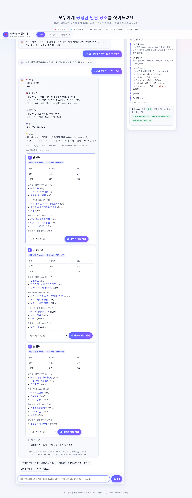

#### S8. 우선순위 되묻기(선택 버튼)

**기대한 동작**: 우선순위가 없으면 선택 버튼으로 되묻고, 버튼 선택은 LLM 없이 처리한다.

**요청 1**: `잠실이랑 건대 사는 둘이 토요일 오후 2시에 데이트` → 결과 `ask/ask` · 1.9초

- 실행 단계: analyze → plan → respond
- Tool 호출: 없음 · 재계획 0회
- LLM 판단: `new_meet` — 사용자가 새로운 약속을 추천해달라고 요청했기 때문에.
- 되묻기: `priority` ['이동 부담 적게', '할 거 많게', '음식점 많게']
- 로깅 Agent 판정: `ok` 
- 최종 응답: '어떤 점을 가장 중요하게 볼까요?'

**요청 2**: `(버튼) 음식점 많게` → 결과 `answer/ok` · 13.1초

- 실행 단계: analyze → plan → execute → judge → respond
- Tool 호출: geo_loc ×2, get_wx ×1, find_stn ×1, get_route ×16, find_spot ×8 · 재계획 0회
- 로깅 Agent 판정: `ok` 
- 최종 응답: '📍 추천   2026-11-21(토) · 건대입구역  🚇 이동시간   - 건대입구역: 잠실 13분 · 건대 6분 (최대 13분, 편차 7분)   - 잠실새내역: 잠실 2분 · 건대 11분 (최대 11분, 편차 9분)   - 구의역: 잠실 6분 · 건대 3분 (최대 6분, 편차 3분)    🍽️ 주변 장소   - 음식점 669곳    ☔ 날씨   비가 내리지 않습니다.    💡 참고   이동시간은 조회 시점 기준이며 약속 시각의 실제 운행과 다를 수 있어요.'

| 순위 | 역 | 이동시간(환승) | 최대/편차 | 점수 | 주변 장소 수 |
|---|---|---|---|---|---|
| 1 | 건대입구역 | 잠실 13분(0), 건대 6분(0) | 13/7분 | 669 | 음식점 669 |
| 2 | 잠실새내역 | 잠실 2분(0), 건대 11분(0) | 11/9분 | 477 | 음식점 477 |
| 3 | 구의역 | 잠실 6분(0), 건대 3분(0) | 6/3분 | 392 | 음식점 392 |

**기대와 실제의 차이**: **없음.** (버튼 응답 턴에는 LLM 판단 이벤트가 없다.)

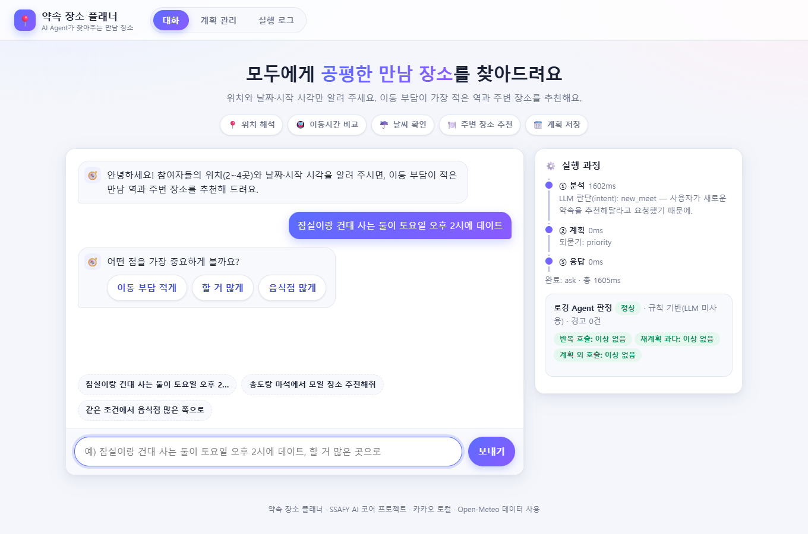

#### S9. API 키 누락

**기대한 동작**: 재계획하지 않고 설정 안내를 표시한다. 키·오류 상세는 노출하지 않는다.

**요청 1**: `잠실이랑 건대 사는 둘이 토요일 오후 2시에 데이트, 할 거 많은 곳으로` → 결과 `error/error` · 1.2초

- 실행 단계: analyze → plan → execute → judge → respond
- Tool 호출: geo_loc ×1 (실패/결과없음: geo_loc:NO_KEY×1) · 재계획 0회
- LLM 판단: `new_meet` — 사용자가 약속 장소 추천을 요청하며 참여자들의 출발 위치, 날짜, 시간, 선호도(할 거 많은 곳)를 명시했습니다.
- 로깅 Agent 판정: `ok` 
- 최종 응답: '카카오 API 키가 설정되지 않았거나 유효하지 않아요. backend 의 .env 에서 KAKAO_REST_KEY 와 서비스 활성화를 확인해 주세요.'

**기대와 실제의 차이**: **없음.** `geo_loc` 1회 호출이 `NO_KEY` 로 실패하고 즉시 안내, 재계획 0회. 화면 상단에 설정 배너도 표시된다.

#### S10. 없는 조건을 임의로 채우지 않는가

**기대한 동작**: 날짜·시작 시각·위치를 지어내지 않고 되묻는다.

**요청 1**: `잠실에서 7시 전에 끝나야 해` → 결과 `ask/ask` · 1.7초

- 실행 단계: analyze → plan → respond
- Tool 호출: 없음 · 재계획 0회
- LLM 판단: `edit_cond` — 사용자가 약속의 종료 시간을 변경하고 싶어함을 나타냅니다.
- 되묻기: `missing` 
- 로깅 Agent 판정: `ok` 
- 최종 응답: '날짜, 시작 시각, 참여자 위치(2곳 이상)을(를) 알려 주세요. 예) "잠실이랑 건대, 토요일 오후 2시"'

**기대와 실제의 차이**: **있음(개발 중 발견·수정 완료).** 처음에는 LLM 이 날짜가 없는 "잠실에서 7시 전에 끝나야 해"에 **오늘 날짜를 채웠다.** 수정: 프롬프트에 "언급이 있을 때만 채움"을 명시하고, 근거 없이 오늘 날짜가 채워지면 코드에서 제거한다 (`drop_unsupported_today`, 단위 테스트). 수정 후 기록은 아래와 같다.

#### S11. 로깅 Agent 를 연결하지 않고 실행

**기대한 동작**: 메인 Agent 가 정상 동작한다 (발행이 구독자에 의존하지 않음).

**요청 1**: `잠실이랑 건대 사는 둘이 토요일 오후 2시에 데이트, 할 거 많은 곳으로` → 결과 `answer/ok` · 5.0초

- 실행 단계: analyze → plan → execute → judge → respond
- Tool 호출: geo_loc ×2, get_wx ×1, find_stn ×1, get_route ×16, find_spot ×32 (실패/결과없음: find_spot:NO_RESULT×5) · 재계획 0회
- LLM 판단: `new_meet` — 사용자가 약속 장소 추천을 요청하며 참여자들의 출발 위치, 날짜, 시간, 선호도(할 거 많은 곳)를 명시했습니다.
- 최종 응답: '2026년 11월 21일 토요일 약속 장소로 건대입구역이 가장 적합합니다. 건대입구역은 잠실에서 13분, 건대에서 6분이 소요되어 최대 이동 시간 90분, 편차 30분 기준을 만족합니다. 또한, 음식점 667개, 카페 175개 등 할 거리가 많은 조건을 충족합니다. 잠실새내역은 잠실에서 2분, 건대에서 11분이 걸리며, 잠실역은 잠실에서 0분, 건대에서 9분이 걸립니다. 이동 시간은 조회 시점 기준이며, 날씨는 맑을 것으로 예상됩니다.'

| 순위 | 역 | 이동시간(환승) | 최대/편차 | 점수 | 주변 장소 수 |
|---|---|---|---|---|---|
| 1 | 건대입구역 | 잠실 13분(0), 건대 6분(0) | 13/7분 | 861 | 음식점 667, 카페 175, 문화시설 14, 관광명소 5 |
| 2 | 잠실새내역 | 잠실 2분(0), 건대 11분(0) | 11/9분 | 571 | 음식점 478, 카페 89, 문화시설 4, 관광명소 0 |
| 3 | 잠실역 | 잠실 0분(0), 건대 9분(0) | 9/9분 | 527 | 음식점 373, 카페 131, 문화시설 18, 관광명소 5 |

**기대와 실제의 차이**: **없음.**

### 개발 중 발견해 수정한 기타 차이

| 차이 | 원인 | 수정 |
|---|---|---|
| 대중교통 첫 호출이 HTTP 400 | 요청 파라미터를 `origin/destination` 으로 가정 | 응답이 알려 준 `start_x/start_y/end_x/end_y` 로 변경 |
| 참여자 바로 옆 역이 "경로 없음"으로 제외될 위험 | 아주 가까운 구간(약 130~300m)에서 방향에 따라 `NO_RESULTS` | 500m 이하는 도보 추정으로 대체하고 표기(`mode=walk_estimate`) |
| 이벤트 발행 중 `TypeError`(단계 종료 이벤트) | `type` 필드명이 `publish(type=…)` 인자와 충돌 | 필드명을 `response_type` 으로 변경, 단계 이벤트 통합 테스트 추가 |
| 동점 3곳의 순서가 불안정 | 점수가 같을 때 보조 정렬 기준 부족 | 이동시간 합 → 최대 이동시간 순으로 정렬 |
| 결과 0건(`NO_RESULT`)이 화면에서 실패처럼 보임 | 표시 문구 구분 없음 | "결과 없음"으로 표기 |
| 로그·계획 시각이 9시간 어긋나 보임 | 서버 UTC 시각을 변환 없이 표시 | 화면에서 한국 시각으로 변환 |
| 이상 진단이 사용자 조건 문제를 Agent 결함으로 결론 | 진단 프롬프트에 구분 기준이 없었음 | 구분 기준 추가, 실제 재진단으로 확인 |
| LLM 을 Gemini 로 실행해 검증 | 명세서 필수 라이브러리는 langchain-openai·openai | GPT(`gpt-4o-mini`, OpenAI 호환)로 통일, Gemini 전용 코드 제거 — 이 문서의 실행 기록은 Gemini 기준이므로 GPT 로 재실행 필요 |

## 4.8 비기능 요구사항 확인 (NF3001~NF3007)

| 번호 | 확인 | 결과 |
|---|---|---|
| NF3001 | 소스코드·제출물에 API 키가 남아 있지 않은가 | ✔ `.env` 를 제외한 **125개 파일**(소스·문서·로그·JSON·스크린샷)에서 실제 `KAKAO_REST_KEY`·`LLM_API_KEY` 값 검색 결과 **0건**, `.env` 는 `.gitignore` 에 포함, `.env.example` 은 값이 비어 있음 |
| NF3002 | 화면에 API 키와 오류 상세가 노출되지 않는가 | ✔ 키 누락 화면(S9)은 안내문만 표시, `/api/health` 는 설정 여부만 반환, 처리되지 않은 예외는 `INTERNAL` 로만 응답 (테스트 `test_unhandled_error_hides_details`, `test_health_reports_presence_not_values`, `test_chat_endpoint_returns_answer_and_timeline` 에서 키 값 미노출) |
| NF3003 | Tool 호출이 실패해도 서비스가 중단되지 않는가 | ✔ S4 (get_route 4회 실패에도 추천 완료), 테스트 `test_unexpected_exception_is_converted` |
| NF3004 | 재계획 상한이 적용되어 무한 반복이 없는가 | ✔ S3 에서 재계획 3회 후 중단, `MAX_REPLAN` 설정 테스트 |
| NF3005 | 대표 요청의 처리 시간이 사용에 지장이 없는가 | ✔ Tool 을 호출하는 요청 10건: **중앙값 10.6초, 최대 23.4초** (LLM 호출 2회 포함, 병렬 호출, 배포 서버(Render 무료)·GPT 기준이며 같은 조건의 로컬 측정은 중앙값 4.3초·최대 6.3초). 가장 오래 걸린 요청은S1(`잠실이랑 건대 사는 둘이 토요일 오후 2시에…`) |
| NF3006 | 프론트엔드·백엔드 분리, Agent·Tool 코드가 파일로 분리되어 있는가 | ✔ `frontend/`(HTML/CSS/JS)와 `backend/`(FastAPI)가 별도 프로세스(포트 5500/8000), `agent/`·`tools/`·`events/`·`store/`·`api/` 파일 분리 |
| NF3007 | 외부 API 출처와 이용 조건(호출 한도·약관)을 기록했는가 | ✔ [01_요구사항정의서.md](01_요구사항정의서.md) 1.2 와 README 에 기록 (카카오 응답 비저장, Open-Meteo CC BY 4.0 출처 표기) |

## 4.9 제출 전 점검 목록

| 항목 | 상태 |
|---|---|
| 필수 기능 F3001~F3019 가 모두 동작한다 | ✔ (4.1~4.5) |
| 선택한 심화 기능(F3020)이 동작하고 필수 기능의 결과와 비교되어 있다 | ✔ 4.6 (정상 실행 `ok` vs 이상 실행 `anomaly`·`unknown` 판정 비교, 필수 기능 결과는 4.7) |
| 증명을 위한 스크린샷과 실행 로그 항목을 모두 첨부했다 | ✔ 스크린샷 29장, 실행 로그 샘플(JSONL·표) |
| 요구사항 정의서 · Agent 설계 문서 · Tool 정의서 · API 명세서 · 구현 소스코드 · 실행 로그 샘플 · README.md 를 모두 포함했다 | ✔ `docs/01~05`, `backend/`·`frontend/`, `docs/samples/`, `README.md` |
| 대표 요청 1건의 전체 실행 로그, 재계획 사례를 포함했다 | ✔ [S1 전체 로그](samples/S1_full_run_log.md), [S2 재계획 로그](samples/S2_replan_run_log.md) |
| 3일차 오후에 제공되는 **셀프 체크리스트**로 점검을 마쳤다 | ✔ [셀프체크리스트.xlsx](셀프체크리스트.xlsx) (통과 26 · 해당없음 5 · 미확인 1 · 실패 0, 증빙 스크린샷 삽입), 요약은 [06_셀프체크리스트.md](06_셀프체크리스트.md) |

## 5. 스크린샷 목록

| 파일 | 내용 | 관련 항목 |
|---|---|---|
| [01_chat_initial.png](screenshots/01_chat_initial.png) | 대화 초기 화면 | F3018 |
| [02_chat_S1_result.png](screenshots/02_chat_S1_result.png) | 한 번에 충족, 추천·근거·실행 과정·판정 | F3005~F3011, F3019 |
| [03_chat_busy.png](screenshots/03_chat_busy.png) | 처리 중 상태 | F3019 |
| [04_chat_ask_priority.png](screenshots/04_chat_ask_priority.png) | 우선순위 선택 버튼 | F3005 |
| [05a_chat_S2_ambiguous.png](screenshots/05a_chat_S2_ambiguous.png) | 위치 모호 되묻기 | F3005 |
| [05b_chat_S2_replan.png](screenshots/05b_chat_S2_replan.png) | 재계획 지점 구분, 결과 재사용 | F3009, F3019 |
| [06_chat_S3_limit.png](screenshots/06_chat_S3_limit.png) | 재계획 상한 도달·사유·완화 버튼 | F3009, NF3004 |
| [06b_chat_S3_relaxed.png](screenshots/06b_chat_S3_relaxed.png) | 완화 후 재탐색 | F3009 |
| [07_chat_S4_tool_failure.png](screenshots/07_chat_S4_tool_failure.png) | Tool 실패, 제외 사유 | F3007, NF3003 |
| [08_chat_S5_no_tool.png](screenshots/08_chat_S5_no_tool.png) | Tool 불필요 요청 | F3006 |
| [09_chat_S6_followup.png](screenshots/09_chat_S6_followup.png) | 후속 요청(Memory) | F3010 |
| [10_chat_S7_missing.png](screenshots/10_chat_S7_missing.png) | 조건 부족 되묻기 | F3005 |
| [10b_chat_S7_answered.png](screenshots/10b_chat_S7_answered.png) | 답변 후 추천 | F3005 |
| [11_chat_S10_no_invention.png](screenshots/11_chat_S10_no_invention.png) | 임의 채움 방지 | F3005 |
| [11b_chat_S9_no_api_key.png](screenshots/11b_chat_S9_no_api_key.png) | API 키 누락 안내 | F3019, NF3002 |
| [11c_chat_S11_no_logging_agent.png](screenshots/11c_chat_S11_no_logging_agent.png) | 로깅 Agent 없이 정상 동작 | F3012 |
| [12_chat_plan_saved_conflict.png](screenshots/12_chat_plan_saved_conflict.png) | 계획 저장·겹침 알림 | F3015 |
| [13_plans_list.png](screenshots/13_plans_list.png) | 계획 목록 | F3015, F3018 |
| [14_plans_edit.png](screenshots/14_plans_edit.png) | 계획 수정 | F3016 |
| [15_plans_after_edit.png](screenshots/15_plans_after_edit.png) | 수정 반영 | F3016 |
| [15b_plans_after_delete.png](screenshots/15b_plans_after_delete.png) | 삭제 반영 | F3016 |
| [16_logs_list.png](screenshots/16_logs_list.png) | 실행 로그 목록 | F3014 |
| [17_logs_detail_anomaly.png](screenshots/17_logs_detail_anomaly.png) | 이상 판정·진단 | F3020 |
| [18_logs_detail_normal.png](screenshots/18_logs_detail_normal.png) | 정상 판정 | F3020 |
| [19_logs_after_delete.png](screenshots/19_logs_after_delete.png) | 로그 삭제 | F3014 |
| [20_api_docs.png](screenshots/20_api_docs.png) | FastAPI 문서 | F3017 |
| [21_logs_F3020_repeated_call.png](screenshots/21_logs_F3020_repeated_call.png) | 반복 호출 이상 판정·진단 | F3020 |
| [22_logs_F3020_unplanned_call.png](screenshots/22_logs_F3020_unplanned_call.png) | 계획 외 호출 이상 판정 | F3020 |
| [23_logs_F3020_unknown.png](screenshots/23_logs_F3020_unknown.png) | 근거 없음 → 판정 불가 | F3020 |
